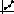
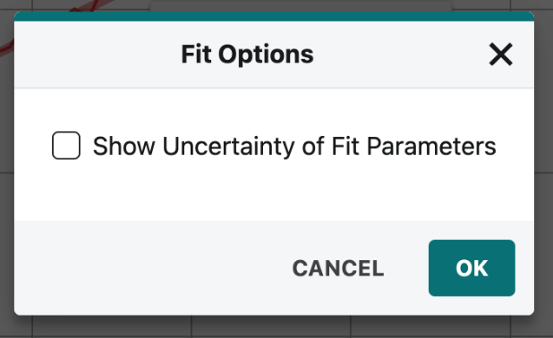
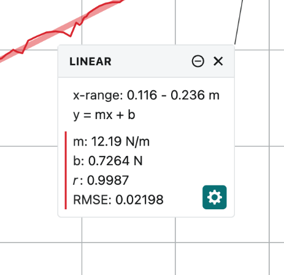

# Lab 5 – Designing an Experiment

## PH211 – General Physics with Calculus

**Experimental goal: Determine whether the given hypothesis is supported or refuted and find an experimental value for a parameter in the model (β).**

Experimental design goes beyond just choosing a procedure. In this lab, you will practice a range of experimental design skills – deciding what data to collect, choosing analysis methods, and quantifying and minimizing the uncertainty in your measurements.

## Learning Objectives

**Learning goal: Decide what data to collect and how to analyze it to achieve a particular goal.**

This lab activity is designed to help you practice the following skills:

1.  Design an experiment to check the predictions of a model.
2.  Understand which factors and design choices contribute to uncertainty.
3.  Identify independent and dependent variables and parameters.
4.  Analyze data by linearizing, plotting, and fitting.
5.  Determine if data supports or refutes a hypothesis.

## Equipment

::: action
- A Go Direct cart and track
- Meter stick
- Cushion
- Crates, blocks, etc. for raising track
:::

## Part 0: Getting familiar with new equipment

For the first time in this course, we will use data collection equipment connected to the computer. The software interface for controlling the equipment is called *Graphical Analysis.* This software can also be used for data analysis.

::: action
- You can run *Graphical Analysis* in a Chrome browser (only Chrome) or use the app.
- The app is on the lab computers, or you can download it onto your own computer for free.
:::

In this lab we will use Vernier motion carts to explore the motion of objects going down ramps. Our carts directly measure their own position over time. Graphical Analysis can calculate the acceleration vs time by numerically differentiating.

:::: box
### Tips for using Graphical Analysis:

::: hint
- Adjust what is displayed using *View* icon, {width="0.1437in" height="0.1437in"} (top right corner). This will allow you to change the number of graphs displayed and to display the data tables.
- Adjust the graph display and fit data using the *Graph Tools* {width="0.1437in" height="0.1437in"} .
- Change what is shown on either axis of a graph by clicking on the axis label.
- Change the data collection by clicking on *Mode* (bottom left) {width="1.6333in" height="0.2333in"}and choosing *Data Collection Settings*.
- The sampling rate (how often the detector measures the position of an object) can also be adjusted in the *Mode* menu.
:::
::::

::: {.question #ph211-designing-an-experiment:get-familiar-with-data}
**Let’s get familiar with the data that the Go Direct carts generate and how it’s used in Graphical Analysis. First, connect the cart to the software.**

::: hint
- When connecting wireless sensors in Graphical Analysis, do *not* connect using the computer’s Bluetooth settings. Connection should be done through the Graphical Analysis app either when it’s opened or by clicking on the connection icon {width="0.3229in" height="0.2363in"} in the lower right corner.
- The cart can be identified by the ID below the bar code.
- Once GA successfully connects to the cart, the flashing red light on the cart will turn green.
:::

a.  **Open up Graphical Analysis and measure a trial run of the cart going down the ramp at a low angle. What data is shown in the software?**

::: hint
- You can display the acceleration vs time graph by clicking the *View* {width="0.1437in" height="0.1437in"} icon in the top right corner. You can also use this menu to display the raw data (a table of numbers) for position, velocity, and acceleration.
:::

b.  **Which part of the cart’s motion are you interested in analyzing? Describe how you can identify where in your plot that part of the motion is happening. (Note that depending on when you hit “Collect” and “Stop”, the detector might record data before the cart starts to move or after it bounces against the foam.)**

::: hint
- You can use the *Zoom* {width="0.2112in" height="0.2167in"} button at the bottom left of each graph to adjust the axes so the data is easier to see. It can be helpful to use the position vs time graph to identify what motion the cart is undergoing at a given time interval.
:::

c.  **How can you extract a value for acceleration from this data for each ramp angle? (Read the hints below on analyzing data in Graphical Analysis.)**

::: hint
- There is more than one way to do this!
- Useful tip: Clicking and dragging on a graph allows you to highlight portions of it. After highlighting a portion of the data, an options menu pops up (or you can click the *Graph Tools* {width="0.1437in" height="0.1437in"} button near the bottom of the graph.
- You can select “View Statistics” to get an info box that includes the average value and the standard deviation (uncertainty) of the highlighted data.
- You can also select “Apply Curve Fit” to fit the highlighted region of the data, then hit “Apply” to display the equation and $r$ value. Note that $r = √R^{2}$. The RMSE (root mean squared error) is also displayed – values closer to 0 indicate better agreement.
:::
:::

Make sure to ask your TA if you have any questions or concerns about how the carts or the Graphical Analysis software work!

## Part 1: Explore a model

Recall from the Hypothesis Testing lab that experiments are designed to check our understanding of the physical world. An idea about how the world works is a **hypothesis**. It is often represented by a **model** that quantifies this idea. In physics, a model is usually an equation. Based on a hypothesis, scientists make specific **predictions** about what will happen in their experiment.

If the data agree with predictions based on the hypothesis, then we say the hypothesis is **supported** by the data, if not, it is refuted. We do not refer to hypotheses as “correct” or “incorrect”, rather we discuss the degree to which data support our hypotheses.

In this lab, we are giving you a model that describes the motion of an object moving down a ramp. Intuitively, you know that as the angle of the track increases and it gets steeper, the cart should roll down at a faster rate.

Exactly how does the cart’s acceleration depend on the angle ϴ above horizontal? One model that you may have seen in class says that the acceleration a down an incline at angle ϴ is given by:

$$\mathbf{a = \beta\ }\mathbf{sin}\mathbf{(\theta)}$$

where $\beta$ is the acceleration due to gravity. This is the model you’ll test in this lab.

## Part 2: Plan the Experiment

Your task is to use your equipment to see if the relationship $a = \beta\ sin(\theta)$ accurately describes the effect of angle on the acceleration of the cart.

::: {.question #ph211-designing-an-experiment:design-an-experiment}
**Design an experiment to test the given model.**

a.  **Which quantities will you directly measure in each experiment, and how?**
b.  **How will you find acceleration from the directly measured quantities? Check with your instructor to make sure your plan makes sense.**
:::

:::: box
### Variables and Parameters

It will help you when designing your experiment to think about the different types of numerical quantities that are involved. It will make your explanation clearer if you label the different quantities appropriately.

*Independent variable*: In an experiment you will usually vary one quantity at a time in a controlled manner. This is the independent variable. Typically, you’re trying to discover how the independent variable affects the system.

*Dependent variables*: Your hypothesis should predict the behavior of other quantities in your system as the independent variable is changed. These other quantities are referred to as the dependent variables because their values depend on the value of the independent variable.

*Parameters*: There are other quantities you should specify because they may influence your results, but that will remain fixed throughout the experiment. These are referred to as parameters. Examples could be the length of a track or the mass of an object. The key is that a parameter doesn’t change at any time in the experiment.

**In short, parameters are fixed, and variables change.** The change is either under your control (independent) or a response to the experiment (dependent).
::::

::: {.question #ph211-designing-an-experiment:list-important-quantities}
**Make a list of the important quantities in the experiment. These are the quantities that will affect or define the motion of the object.**

a.  **Identify which you plan to change in a controlled manner. List that as the independent variable. Select a range of values to test in your experiment and make sure it’s part of your description.**

::: hint
- Note: You should only be controlling one quantity at a time. If you believe your experiment has two independent variables, talk about it with your instructor.
:::

b.  **Identify the quantity or quantities that you expect to change as you vary the independent variable. List these as the dependent variables. Next to each, briefly describe how you expect it to change as the independent variable changes.**
c.  **Finally, list those quantities that you expect to remain fixed throughout the experiment as your parameters. Focus on those that define your experiment - in other words, those which would change the results if you were to change them.**
:::

::: {.question #ph211-designing-an-experiment:estimate-measurement-uncertainty}
**Estimate the *measurement* uncertainty in the acceleration using the method described below.**
:::

::: hint
- Remember that **human error is not a valid source of uncertainty!** Use the uncertainty accounting ideas you learned in the Uncertainty lab earlier this term (you can refer to the [Appendix](#_What_is_Uncertainty?) of this lab for a reminder.)
:::

### Finding measurement uncertainty using Graphical Analysis

For simplicity, we’ll assume that the most significant source of measurement uncertainty comes from fluctuations as the cart records position (and hence velocity and acceleration) over time.

Take a look at the trial-run data you collected and estimate a value for the uncertainty in the acceleration using one of the methods below.

::: hint
- Make sure you only evaluate data taken during the time the cart was rolling down the ramp, by highlighting only that portion of the graph. You may want to ask your instructor to check that you’re choosing this data correctly.
:::

1.  If you chose to find the acceleration by taking an average value of the calculated accelerations throughout the trial, you can use standard deviation as your uncertainty. This statistic is shown in the info that pops up when you click “View Statistics” after highlighting a portion of data.
2.  If you chose to find acceleration by fitting a line to the velocity vs time data and using the slope from the fit equation, Graphical Analysis can tell you the uncertainty in the slope. After you click “Apply Fit”, select “Options” and check the box (there’s only one!) to show the uncertainty in the fit parameters.

{width="2.8097in" height="1.7194in"}{width="1.7089in" height="1.6197in" crop="10822 9940 7992 10517"}

::: hint
- Keep in mind that when you do the experiment you should run multiple trials, and that **you will also have a statistical uncertainty due to the run-to-run variation**.
:::

::: {.question #ph211-designing-an-experiment:plan-your-analysis}
**Plan your analysis. Don’t actually do the analysis now, but your plan should allow you to answer the following:**

::: action
- Does the data follow $\mathbf{a\  = \ \beta\ sin(ϴ)}$? Is that the best relationship to explain your data?
- What value do you get for *β*? Considering your uncertainty, is this value consistent with our statement that *β* represents the acceleration of gravity?
- Is there a non-zero x-intercept in your plot(s)? If so, what does it represent physically?
:::

a.  **Describe a graph or graphs you can use to answer the above questions – state what quantity will go on each axis. [You are testing a nonlinear hypothesis, so at least one graph you make should be]{.underline} [linearized](#_Linearization).**
b.  **How will you use your data to find the effect of angle on acceleration, and how will you compare this to the prediction given above? What outcome would support the hypothesis? Your comparison should be quantitative.**
c.  **How will you determine the acceleration of gravity from your data?**
:::

::: hint
- **[IMPORTANT]{.underline}:** You should not be doing calculations with each data point, but rather using a linearized graph to find a value for *β*. If you’re not sure how to do this, ask your instructor.
:::

## Part 3: Collect Data

You should now be ready to run your experiment. Remember, every good experiment should involve doing multiple trials!

::: {.question #ph211-designing-an-experiment:run-the-experiment}
**Run the experiment that you planned and record what you observe. Don’t try to explain the results, simply record your observations.**

a.  **Describe in words what you observed, including any changes you made to your procedure.**
b.  **Make and include in your report a data table of your measurements that you can use for your analysis. Make sure all columns are labeled and have units.**
c.  **For each value of the independent variable that you test, calculate and report the statistical uncertainty in the dependent variable that you measure.**
:::

## Part 4: Analyze the Data

::: {.question #ph211-designing-an-experiment:analyze-your-data}
**Analyze your data using the method(s) you described above.**

::: hint
- Include the uncertainty in your results by including error bars in your plot.
:::

a.  **Add any graphs you created to your lab report. Remember, all graphs need a title, axis labels with units, and an equation and R^2^ value for any trendlines.**
b.  **Does your fit fall within the error bars?**
c.  **Report your value for *β* and briefly show or describe how you found it.**
d.  **Find and report the uncertainty in *β* using the method below.**
:::

### Finding uncertainty in a slope:

1.  Type the function shown below into a cell in your Excel spreadsheet.

=LINEST(*y-data range*, *x-data range*, TRUE, TRUE)

{width="3.2028in" height="1.4833in" crop="0 3262 0 0"}

3.  The function outputs two columns of values. The uncertainty in the slope is the second box down in the left column.

{width="2.8705in" height="1.3083in"}

4.  You can also use Graphical Analysis to find the uncertainty in a slope using the “Display Fit Parameters” option described earlier in the lab.

## Part 5: Draw Conclusions

::: {.question #ph211-designing-an-experiment:results-follow-expected-relationship}
**Based on your analysis, including uncertainty, state whether your results follow the expected relationship between angle and acceleration as given by the equation for acceleration in the hypothesis. State your value for *β* (including uncertainty) and whether this agrees with the accepted acceleration of gravity. Defend your conclusions using evidence from your analysis.**
:::

::: {.question #ph211-designing-an-experiment:make-results-more-robust}
**What are things you did to make your results more robust or reduce uncertainty? If you were to run the experiment again, what, if anything, would you do differently? If you have nothing you would change, explain why you feel your procedure was optimal.**
:::

## Part 6: Submit Your Group’s Lab Report

Make sure everyone’s name is on your group’s lab report. If you submit through Gradescope remember to add everyone in your group to the assignment. This is done at the end of the submission process.

## Appendix – Reference Information

This section contains key information from previous labs:

1.  Required Plot Elements
2.  Linearization
3.  What is Uncertainty?
4.  Sources of Uncertainty
5.  Predictions, Hypotheses, and Models

### Required Plot Elements

::: action
- Do not connect the data points with lines.
- Make sure you create *Scatter Plots* and not *Line Plots*.
- Evaluate if the plot makes sense. Are the axes correct? Do you have the right number of data points?
- Include a descriptive title and labels on each axis, always including physical units.
- Add a legend, unless you only have one set of data and the title describes it.
- Display the equation and R^2^ value for any trendline you include.
:::

### Linearization {id="_Linearization"}

In the context of data analysis, “linear” refers to a directly proportional relationship between the dependent and independent variables in an equation.

::: action
- Mathematically, if two variables $x$ and $y$ have a linear relationship, we can express this as $y = mx + b$ where m and b are constants.
- More simply, we can write this as $y \propto x$ where $\propto$ means “is proportional to”.
- When graphed, data with a linear relationship falls on a straight line.
:::

**Linearization comes in handy when your data or hypothesis is *not* linear.**

When you fit data with a linear trendline, you are essentially checking whether the two variables are proportional to each other. To check a nonlinear hypothesis, can we instead check if one variable is proportional to *a function of* the other variable.

In practice, **linearization is done by calculating a new column of data** that gives the values of a function of the input variable. Typically, the input variable is the independent variable, and the function is chosen so that the resulting quantity is proportional to the dependent variable.

**Why Linearize?**

::: action
- Linear data is typically easier to understand and analyze.
- There are analysis methods we can apply to linear data that don’t work as well (or at all) with nonlinear data.
- It is relatively easy to fit a line to data - there are just two important values to determine: the slope and intercept of the data.
:::

### What is Uncertainty? {id="_What_is_Uncertainty?"}

*Uncertainty* is the acknowledgement that we cannot measure things exactly, and so any conclusion based on measurements will always include a range of possible answers. When making a measurement, there is no single “true value” of the measurand (measured quantity) that we can determine. Instead, we can define an interval that defines the range of values that we think are *probable* for the measurand. The narrower the interval, the more precisely we can approximate the measurand.

When including uncertainty in a value, we report it as **A ± Δ~A~**. We believe the value is **A**, but we’re unable to rule out the possibility that it’s higher or lower by an amount **Δ~A~**. (Sometimes it’s written +Δ~1~ / -Δ~2~ if the higher and lower ranges are different.) For example, a time might be reported as 2.45 s ± 0.03 s.

### Sources of Uncertainty:

The uncertainty in a measurement can be due to a combination of several factors. A crucial aspect of experimentation is to identify all such sources of uncertainty and to numerically estimate their effect on your measurement result.

Common sources of uncertainty include:

a)  the effects of environmental conditions on the measurement
b)  your judgement in reading analogue instruments
c)  the sensitivity of your instruments (e.g. the digital scale)
d)  the rating or stated calibration of the instrument
e)  approximations and assumptions that you make while doing the experiment
f)  variations in repeated readings made under apparently identical conditions

**[Predictions, Hypotheses, and Models]{.underline}**

Experiments are designed to check our understanding of the physical world. An idea about how the world works is a **hypothesis** and is often represented by a **model** that quantifies this idea. In physics, a model is usually an equation. Based on a hypothesis, scientists make specific **predictions** about what will happen in their experiment.

For an experiment to be a valid test of a hypothesis, it must be designed so that the data (and subsequent analysis) can either agree or disagree with the prediction. If the data agree, then we say the hypothesis is **supported** by the data, if not, it is refuted.

We do not refer to hypotheses as “correct” or “incorrect”, rather we discuss the degree to which data support our hypotheses. Models are always just that - a model to describe what we observe. Experiments help us determine to what degree our model works.
