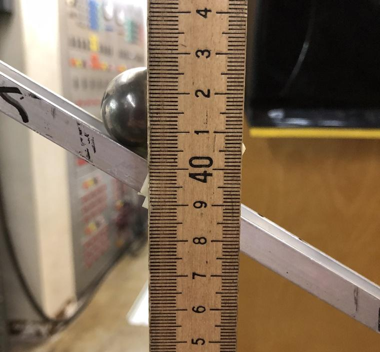
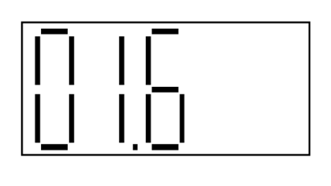
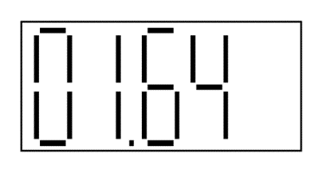
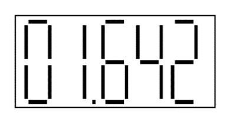

# Lab 3 – Uncertainty

### PH211 – General Physics with Calculus

**Experimental goal: Quantify the uncertainty in the time of flight for a ball bearing. Use error bars to compare class results.**

Uncertainty refers to limitations on our ability to make accurate measurements due to equipment and experimental design. This lab will investigate why we have uncertainty and how uncertainty in measurements leads to uncertainty in results.

### Learning Objectives

**Learning goal:** **Explore what uncertainty is, learn how to quantify it, and see how it can be used to interpret results.**

This lab activity is designed to help you practice the following objectives:

1.  Collect data using available equipment.
2.  Identify major sources of uncertainty and the effects they have on results.
3.  Combine uncertainty from different sources in quadrature.
4.  Design experimental procedures to reduce uncertainty.
5.  Include uncertainty when making conclusions.

### Equipment

::: action
- An inclined metal ramp
- A metal ball
- Landing pad
- Meter stick
- Measuring tape
- Calipers
- Stopwatch
:::

### Part 1: Uncertainty in a Single Measurement

Consider the image given below in Figure 1. It is a picture of a metal ball just before it is rolled down a ramp.

{width="3.4528in" height="3.2049in"}

**Figure 1:** Measuring Height

::: {.question #ph211-uncertainty:determine-height}
**Discuss with your lab partners how each of you would determine the height of this ball. (For example, which part of the ball do you measure to?) Come to a consensus on how you should do this. What did you decide, and why did you choose this method?**
:::

::: box
#### What is Uncertainty?

*Uncertainty* is the acknowledgement that we cannot measure things exactly, and so any conclusion based on measurements will always include a range of possible answers. When making a measurement, there is no single “true value” of the measurand (measured quantity) that we can determine. Instead, we can define an interval that defines the range of values that we think are *probable* for the measurand. The narrower the interval, the more precisely we can approximate the measurand.

When including uncertainty in a value, we report it as **A ± Δ~A~**. We believe the value is **A**, but we’re unable to rule out the possibility that it’s higher or lower by an amount **Δ~A~**. (Sometimes it’s written +Δ~1~ / -Δ~2~ if the higher and lower ranges are different.) For example, if we’re confident a time is between 2.42 and 2.48 s, it would be reported as 2.45 s ± 0.03 s.
:::

::: {.question #ph211-uncertainty:height-determined}
**What height did you determine for the ball?**
:::

::: {.question #ph211-uncertainty:lowest-highest-probable}
**Read the box above about uncertainty. Discuss with your group what you think the lowest probable value is for the height of the ball in the picture. What about the highest probable value? Record your answers here.**
:::

::: hint
- **One way of quantifying the *uncertainty* in your measurement is by taking it as half of the range between these two estimates.**
:::

The uncertainty in a measurement can be due to a combination of several factors. A crucial aspect of experimentation is to identify all such sources of uncertainty and to numerically estimate their effect on your measurement result. Common sources of uncertainty include:

a)  your judgement in reading analogue instruments; (see Question 3)
b)  the effects of environmental conditions on the measurement; (see Question 4)
c)  the sensitivity of your instruments (e.g. a digital scale, a meter stick); (see Question 5)
d)  the rating or stated calibration of the instrument; (see Part 2)
e)  approximations and assumptions that you make while doing the experiment; and
f)  variations in repeated readings made under apparently identical conditions (see Part 2).

A measurement uncertainty is not meant to be an indication of “mistakes” that you might make in an experiment. If you are aware that you have made a mistake, then you should repeat your experiment. “Human error” is not a valid source of uncertainty. If you know that you did something “wrong”, then the right course of action is to do it correctly.

::: {.question #ph211-uncertainty:flat-surface-humid-air}
**How might your estimate of the height of the ball change if it were on a flat surface instead of a ramp? What might your uncertainty be in that case? What if the air were very humid, causing your wooden meter stick to expand slightly? (These are examples of the effects of environmental conditions on your measurement.)**
:::

::: {.question #ph211-uncertainty:centimeter-markings}
**How might your estimate of the height of the ball change if the meter stick only had markings for each centimeter, instead of each millimeter? What might your uncertainty be in that case? (This is an example of the sensitivity of your instruments and your judgement in reading it.)**
:::

### Part 2: Statistical Uncertainty

You will now measure how long it takes a ball to hit the ground after rolling down a ramp from a certain height. (Your instructor will assign or tell you how to choose your height.) Your objective is to determine as accurately as possible how long the ball is in the air **starting from when it leaves the ramp and ending when it hits the ground**.

In order to measure the time, we will be using a digital stopwatch. Digital measurement tools have uncertainties associated with them, just like analog measurement tools.

Below is a table showing a digital readout of a stopwatch with different levels of sensitivity. The sensitivity of the digital instrument will determine what we estimate the uncertainty *associated with the instrument* to be.

::: {.question #ph211-uncertainty:fill-in-blanks-rule}
**Fill in the blanks in the last two rows of the table. Write a description of the general rule for estimating the uncertainty in a digital instrument based on the information in the table.**
:::

Remember, uncertainty typically comes from multiple sources! Uncertainty from the instrument used to make a measurement is just one source of uncertainty.

+------------------------------------------------------------------------------------------------------------------------------------------------+---------------------------------------------------------------------+
| **The stopwatch display reads:**                                                                                                               | **Inference about the time in the air, based only on the reading:** |
+:==============================================================================================================================================:+:===================================================================:+
| {width="1.7766in" height="0.9993in"}     | **The time on the stopwatch lies between**                          |
|                                                                                                                                                |                                                                     |
|                                                                                                                                                | **1.55 sec and 1.65 sec**                                           |
+------------------------------------------------------------------------------------------------------------------------------------------------+---------------------------------------------------------------------+
| {width="1.7766in" height="0.9993in"}   | **The time on the stopwatch lies between**                          |
|                                                                                                                                                |                                                                     |
|                                                                                                                                                | **\_\_\_\_\_\_\_\_ sec and \_\_\_\_\_\_\_\_ sec**                   |
+------------------------------------------------------------------------------------------------------------------------------------------------+---------------------------------------------------------------------+
| {width="1.7778in" height="1.0000in"} | **The time on the stopwatch lies between**                          |
|                                                                                                                                                |                                                                     |
|                                                                                                                                                | **\_\_\_\_\_\_\_\_ sec and \_\_\_\_\_\_\_\_ sec**                   |
+------------------------------------------------------------------------------------------------------------------------------------------------+---------------------------------------------------------------------+

::: {.question #ph211-uncertainty:other-factors}
**What are some other factors that might affect the value that you measure for the length of time the ball is in the air? Identify at least two possible factors. For each factor that you identify, state whether you think it affects your measurement in a large way or a small way.**
:::

::: hint
- **You may find it helpful to refer to the list of common sources of uncertainty earlier in the handout.**
:::

One example of a factor that can affect our measurements is the *reaction time* of the person operating the stopwatch.

::: {.question #ph211-uncertainty:reaction-time}
**Determine and describe a way to find your reaction time with the stopwatch. Report the value that you decide on here. This should be a reaction to an *external* event, not something you initiate yourself. You may want to discuss your idea with your instructor.**
:::

### Part 3: Collect Data

Now that you understand your measurement tools and process a bit more, you are ready to collect some data.

::: action
- Place the provided ball on your track and measure the height of the ball. Make the most accurate determination you can. Estimate how accurate you think this measurement is.
- Next release the ball from this point. Make sure it is oriented to roll off the ramp without hitting the table and has enough space to hit the floor.
:::

::: {.question #ph211-uncertainty:record-trials}
**Record both the starting height of the ball and the time it was in the air. Do a minimum of five trials – that is, drop the ball at least five times from the same height (as closely as possible) and take a time measurement for each drop. Use a table with labeled columns to neatly report your results.**

a.  **Are all of these numbers the same? Does this mean the ball actually took a different amount of time for each trial?**
:::

When we have multiple measurements of a single value, we want to report a single value that captures all of the information we have about that value. We can also use the spread of the measurements to provide another contribution to the uncertainty.

::: {.question #ph211-uncertainty:average-statistical-uncertainty}
**Calculate the average time from all of your trials. Now calculate the *statistical uncertainty*, the uncertainty associated with the spread of all of the measurements you made, using one of the two methods below.**

a.  **One method for calculating this uncertainty is to take half of the difference between the largest and smallest measurement you made.**
b.  **Another method is to calculate the standard deviation of your measurements.**
:::

We now want to quantify the total uncertainty in the average measurement. Remember, uncertainty comes from a variety of sources, and we want to take all of them into account. Ultimately, the goal of uncertainty is to answer the question:

> “From my data (and other information that I might have), what do I know about the measurand?”

::: {.question #ph211-uncertainty:three-estimates}
**You should now have (at least) three estimates of the uncertainty in your measurement of the fall time of the ball, from three different sources – the stopwatch reading, the reaction time, and the statistical uncertainty from multiple measurements.**

a.  **Are all three values similar in size? Is there one that is much smaller or much larger than the others? If there is one source that is much larger than the others, we say that source *dominates* the uncertainty. If there is one source that is much smaller than the others, we say that source of uncertainty is *negligible*.**
b.  **Combine the three values of uncertainty into a single value of the total uncertainty with the following formula:**

    $$\mathbf{\Delta}\mathbf{t}_{\mathbf{total}}\mathbf{=}\sqrt{\left( \mathbf{\Delta}\mathbf{t}_{\mathbf{1}} \right)^{\mathbf{2}}\mathbf{+ \ }\left( \mathbf{\Delta}\mathbf{t}_{\mathbf{2}} \right)^{\mathbf{2}}\mathbf{+ \ }\left( \mathbf{\Delta}\mathbf{t}_{\mathbf{3}} \right)^{\mathbf{2}}}$$

    **This is called *adding in quadrature*. This same formula can be extended and used for any number of sources by changing how many terms are under the square root. If a source is negligible, you can omit it from the formula.**
:::

**Share your result with the class. (Your instructor should tell you how.) Make sure to report your starting height, your average time, and your total uncertainty in the time.**

### Part 4: Analyze the Data

::: {.question #ph211-uncertainty:plot-time-vs-height}
**Make a plot of time vs. starting height using the class data. Include the uncertainty for each value as error bars on your plot. (You’ll need the desktop version of Excel; instructions are in the Excel Skills document and in the appendix of this lab handout.) Include the plot in your report.**
:::

::: {.question #ph211-uncertainty:analyze-class-results}
**Analyze the class results:**

a.  **If the uncertainties of two measurements overlap, we say that those measurements agree. That is, as far as we are able to tell, there is a reasonable likelihood that the measurements represent the same data. Based on the class data, are there any measurements that agree?**
b.  **What can you conclude about the relationship between height and time? How do those conclusions depend on the uncertainties?**
c.  **Is this what you expected?**
:::

When each group has had a chance to complete their measurements, your instructor will lead a class discussion about this activity.

### Part 5: Reflect and Conclude

This lab activity was designed to show how limitations on how well we can measure things creates a level of uncertainty in our results.

:::: {.question #ph211-uncertainty:individual-reflection}
**Each lab member should write an individual concise paragraph reflecting on the lab. Identify each contribution by name. Each should specifically address the following:**

::: action
- **Is the outcome of a successful measurement a single value or an interval?**
- **Can the “true” value of a measurand ever be known?**
- **Why is it important to report the uncertainty of a measurement?**
- **Are there any remaining questions or confusions for you about today’s lab activity?**
:::
::::

### Part 6: Submit Your Group’s Lab Report

Make sure everyone’s name is on your group’s lab report. If you submit through Gradescope remember to add everyone in your group to the assignment. This is done at the end of the submission process.

## Appendix – Error Bars

#### **To add error bars to a plot in Excel:**

1.  Click the data set you want to add error bars to, and then under “Chart Design”, select “Add Chart Element” → “Error Bars” → “More Error Bar Options”
2.  Both horizontal and vertical error bars will be added. We usually just want vertical error bars, so select the horizontal error bars and delete them
3.  Under “Format Error Bars” → “Error Amount” select “Custom”
4.  Click “Specify Value” and highlight the uncertainty values for both the positive and negative error bar values
5.  Repeat for each dataset that needs error bars

Note: adding custom error bars is only available in the desktop version of Excel. Excel Online and Google Sheets only have options for constant error bars.

## Appendix – Reference Information

This section contains key information from previous labs:

::: {.numbered anchors="o14.0.1 o14.0.2"}
1.  Required Plot Elements
2.  Linearization
:::

#### **Required Plot Elements**

::: action
- Do not connect the data points with lines.
- Make sure you create *Scatter Plots* and not *Line Plots*.
- Evaluate if the plot makes sense. Are the axes correct? Do you have the right number of data points?
- Include a descriptive title and labels on each axis, always including physical units.
- Add a legend, unless you only have one set of data and the title describes it.
- Display the equation and R^2^ value for any trendline you include.
:::

#### Linearization

In the context of data analysis, “linear” refers to a directly proportional relationship between the dependent and independent variables in an equation.

::: action
- Mathematically, if two variables $x$ and $y$ have a linear relationship, we can express this as $y = mx + b$ where m and b are constants.
- More simply, we can write this as $y \propto x$ where $\propto$ means “is proportional to”.
- When graphed, data with a linear relationship falls on a straight line.
:::

**Linearization comes in handy when your data or hypothesis is *not* linear.**

When you fit data with a linear trendline, you are essentially checking whether the two variables are proportional to each other. To check a nonlinear hypothesis, can we instead check if one variable is proportional to *a function of* the other variable.

In practice, **linearization is done by calculating a new column of data** that gives the values of a function of the input variable. Typically, the input variable is the independent variable, and the function is chosen so that the resulting quantity is proportional to the dependent variable.

**Why Linearize?**

::: action
- Linear data is typically easier to understand and analyze.
- There are analysis methods we can apply to linear data that don’t work as well (or at all) with nonlinear data.
- It is relatively easy to fit a line to data - there are just two important values to determine: the slope and intercept of the data.
:::
