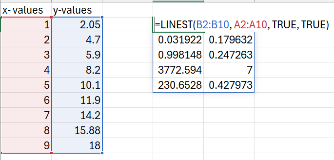
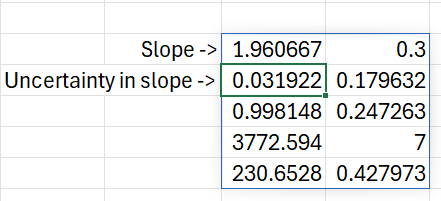
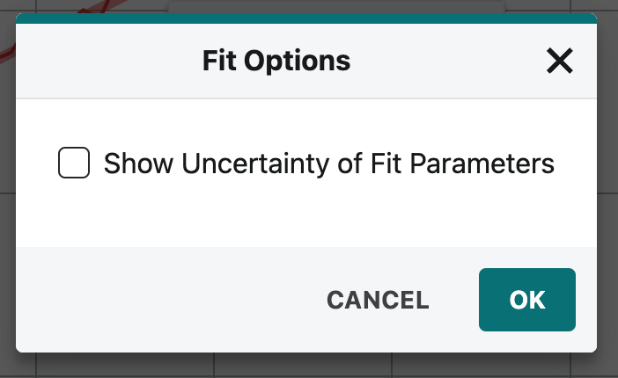
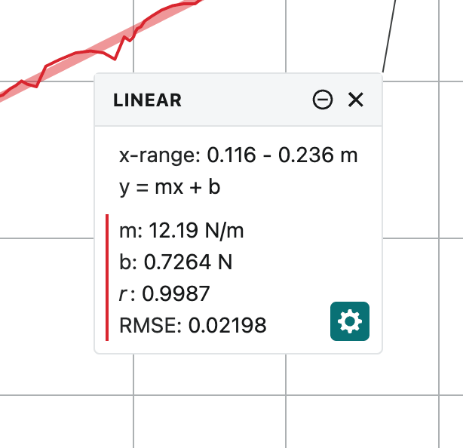

# Capstone – Design an Experiment

### PH212 – General Physics with Calculus

**Experimental goal: Investigate a model of a phenomenon we haven’t explored in lab. Then design, execute, and analyze an experiment to test predictions based on the model.**

Options (explained in more detail in the handout):

  ----------------------------------------------------------------------------------
   **Phenomenon:**   **Explore the dependence on:**   **Additionally test either:**
  ----------------- -------------------------------- -------------------------------
        Drag                     Speed                Mass or Cross-sectional area

       Damping                 Ramp angle               Mass or Initial amplitude
  ----------------------------------------------------------------------------------

[This lab activity spans two weeks]{.underline}**.** Here’s how the project is structured:

Week 1

1.  Choose a phenomenon to investigate from the options above
2.  Build a model and use it to make predictions
3.  Design an experiment to test your predictions

Week 2

4.  Perform your experiment
5.  Determine if your results support your model

::: box
#### If you miss Week 1 of this activity:

If you are able to attend the second week of this lab, you’ll complete the activities for Week 1 during that lab period and complete the Week 2 activities during a makeup lab session. You may work with other students who missed Week 1 as well.
:::

### Learning Objectives

**Learning goal: Put all of the skills you learned this term into practice and experience one full cycle of the scientific process.**

This lab activity is designed to help you practice the following skills:

Design an experiment to test a hypothesis.

Use available equipment to collect data in a systematic way.

Analyze data as appropriate.

Use quantitative evidence such as R^2^ value for a particular fit to support conclusions.

### Skill building: Custom fits in Graphical Analysis

**For this lab you will need to use the Custom Curve Fit feature of Graphical Analysis.** Here we explain how to use this feature.

::: box
#### Creating a custom curve fit in Graphical Analysis

Custom Curve Fits in GA allows us to fit any model and quickly find the parameters of that fit.

::: hint
- Custom Curve Fits is only available in the Pro mode of GA. If your copy of GA isn’t already upgraded, use (1) to open the browser version or (2) to upgrade your copy to Pro.
:::

1)  [Open the Pro version of GA in a browser](https://graphicalanalysis.app)
2)  Upgrade the version of GA on your computer
    - Click the three dots in the top right corner of the program and click “About”
    - Enter the key that your instructor gives you. It may also be posted on the wall of the classroom. Contact your instructor if you need outside of class.
    - If prompted, DO NOT try to update the program.

Once you have access to Pro, we can use the power of Custom Curve Fits.

::: hint
- Select the relevant data in GA, or leave it unselected to use all the data.
- Select “Apply Curve Fit” from the menu that appears or by clicking on the graph symbol in the lower left corner.
- The program will default to a linear fit, but we want to click “Create Custom Fit”
- Enter the model equation to try using mathematical notation.
    - For example *y=Ae^x^+Bx-Csin(x)* would be entered as *A\*exp(x)+B\*x-C\*sin(x).*
    - Note that your independent variable must be referred to as *x* in your equation.
- GA will find the best values of each parameter (in this case A, B, & C) that fit your model to the data!
- We can show the uncertainty in the fit parameters by clicking the gear that appears in the box. Very helpful!
:::
:::

::: box
**[SKIP THIS IF YOU DID IT IN THE PRE-LAB]{.underline}**

**Try it out!** Download the GA data file from [this google drive link](https://drive.google.com/file/d/1h-bKuXY-w09vTH70dI0Uo3K4v4Rl9oP6/view?usp=sharing) and save it to a place you can access. ([You must be logged into google drive with your ONID]{.underline}). Open it in GA. (Click on *open and* select the data file.)

::: hint
- The file contains a data set that follows the form: *y = A\*x + B\*x^2^ + C\*sin(x).* (Note that *x^2^* should be entered as *x\^2*.) **Try fitting a curve of this form using the procedure described in the box above. Find the values for A, B, and C as well as their associated uncertainties. Which parameter is negative? What does that mean?**
:::
:::

### Phenomena to Investigate {#_Phenomena_to_Investigate}

For your project in this lab, you will test a model for **one** of the following phenomena, focusing on the relationship between the force and two other variables:

1)  **Drag**: Does the drag on an object depend on its speed? In addition, how does it depend on either the mass of the object or its cross-sectional area?
2)  **Damping**: How does the damping on an oscillating object on a ramp depend on the ramp angle? In addition, how does it depend on either the mass of the object or the initial amplitude of the oscillation?

Your lab should investigate [quantitative]{.underline} relationships. A quantitative relationship allows you to calculate a value such as force, e.g., **F** = m**g**. That is, given the values of the inputs (like mass and gravity), your model should be able to calculate *numbers* for the result (like force). You will use your model to make quantitative predictions to be experimentally tested.

To help you, we provide equations and information below on each phenomenon. They include algebraic *factors* that are determined through fits to the data. You should relate the factors in the provided equation to the topics you need to explore. That is, think about the physics meaning of each factor. You may research your topics online to help your understanding. You should cite any sources you use.

### Models and equations for each phenomenon

**[Model 1 – Drag]{.underline}**

Drag refers to air resistance on a moving object. There are different models for drag. In general it increases with the speed of an object, though at low speeds it’s possible that it may be constant, that is, independent of speed. This experiment is designed to see which of these better describes carts rolling down a ramp.

We start with equations for the speed of the cart as a function of time for each model. These equations assume the cart starts at rest at time *t~0~, [so it’s important that you only fit to data taken after the cart is released / starts moving.]{.underline}*

The first case, for constant drag, you may have covered in lecture. The drag is simply a constant, $\mathbf{F}_{\mathbf{D}}\mathbf{=}\mathbf{b}_{\mathbf{0}}$, and the speed is given by
$$\mathbf{v}\left( \mathbf{t} \right)\mathbf{=}\left( \mathbf{g}\mathbf{sin\theta - \ }\frac{\mathbf{b}_{\mathbf{0}}}{\mathbf{m}} \right)\left( \mathbf{t -}\mathbf{t}_{\mathbf{0}} \right)$$

For the second case we will assume the drag increases linearly with speed, that is, $\mathbf{F}_{\mathbf{D}}\mathbf{=}\mathbf{b}_{\mathbf{1}}\mathbf{v}$. In this case the equation for speed is

$$\mathbf{v}\left( \mathbf{t} \right)\mathbf{=}\frac{\mathbf{mg}\mathbf{sin\theta}}{\mathbf{b}_{\mathbf{1}}}\mathbf{\times}\left( \mathbf{1 -}\mathbf{e}^{\mathbf{-}\frac{\mathbf{b}_{\mathbf{1}}}{\mathbf{m}}\left( \mathbf{t -}\mathbf{t}_{\mathbf{0}} \right)} \right)$$

[A few important notes about these equations:]{.underline}

::: action
- *m* is the mass of the object and *θ* is the angle of the ramp from horizontal. As is often the case, *g* is the acceleration of gravity.
- *b* is a constant in the drag equations that depends on the physical configuration of the cart, especially its cross-sectional area and shape. *It is not the same for the two situations*, so we have added a subscript in each equation.
- Treat the starting time *t~0~* as a parameter. As long as you fit data starting at the moment you released the cart, Graphical Analysis should fit to the value of *t~0~.*
:::

*If you choose to investigate this model:*

1)  You need to determine which model better describes a cart rolling down a track – constant drag ($\mathbf{F}_{\mathbf{D}}\mathbf{=}\mathbf{b}_{\mathbf{0}}$), or drag that increases linearly with speed ($\mathbf{F}_{\mathbf{D}}\mathbf{=}\mathbf{b}_{\mathbf{1}}\mathbf{v)}$. One way to do this is to compare measured velocity with the equations given above for ***v(t)***.
2)  You will repeat your experiment for either different masses or cross-sectional areas, determining in each case which model works better.
3)  In each case you should find the value of ***b*** from a fit of your data. You’ll look for a trend in ***b*** and interpret what that may mean physically.

**[Model 2 – Damped oscillations]{.underline}**

An equation describing the position of a damped oscillator over time is

$$\mathbf{x}\left( \mathbf{t} \right)\mathbf{= A}\mathbf{e}^{\mathbf{- Bt}}\mathbf{\cos}{\left( \mathbf{Ct + D} \right)\mathbf{+ E}}$$

*A, B, C, D,* & *E* are factors specific to the system & oscillation being studied.

*If you choose to investigate this model:*

1)  First interpret the above equation and provide the physical meaning of each factor. Choose the factors related to damping and frequency. (You can get help from your instructor, but you should first attempt to do this on your own.)
2)  Explore the effect of angle – Determine if changing the angle of the ramp affects the damping and the frequency, and what that effect is. Be quantitative.

::: hint
- Note that your conclusion on frequency won’t necessarily be the same as in our previous lab on oscillations, in which we avoided damping.
:::

3)  Finally, describe the effect on the damping and frequency, if any, due to changing either the mass or the initial amplitude of the system. Once again, be quantitative.

:::: landscape
::: box
#### Remember, an experiment always:

1.  Starts with a hypothesis, a model describing the behavior of a system
2.  Uses the model to make a measurable prediction about what will happen in a specific situation
3.  Creates the situation experimentally such that the prediction can be measured
4.  Compares the results of the experiment to the predicted behavior
5.  Makes a statement on the validity of the hypothesis
    a.  which is supported if the results match the prediction
    b.  which must be modified if not, in which case the results should be used to suggest possible modifications or changes
:::

### Evaluation

**Week 1 activities will be graded for completion**, and feedback will be provided by your TA. You will use your responses and the feedback you receive to write part of your final report during Week 2.

**The following criteria will be used to grade each part of the final lab report (your submission for Week 2).** You can refer to it as you work to make sure you are addressing the questions fully.

| Task | 1 | 2 | 3 | 4 |
|:------------|:--------------------------|:--------------------------|:--------------------------|:--------------------------|
| Describe model and predictions | Model and research questions are unclear. | Describes model, with some research question implied. | Describes model, including essential variables to investigate. A research question and prediction(s) are implied or are qualitative rather than quantitative. | Describes model, including equations and essential variables to investigate. Clearly states research questions and specific predictions for each relationship being tested. Lists group members. |
| Describe procedure | Procedure is unclear and missing important pieces. Does not adequately address how uncertainty will be quantified. | Describes a procedure with some details missing. Mentions uncertainty but does not fully address how it will be quantified. | Describes a procedure with ordered steps. Explains most aspects of how uncertainty will be quantified for relevant quantities. | Describes a procedure with clear, ordered steps that could be followed to replicate the experiment. Explains how measurement and statistical uncertainty will be found for relevant quantities and how they will be combined. |
| Do the experiment / collect data | Reports data, including parameters that were changed/measured and those that were held constant, but many parameters may be missing. | Reports data, including parameters that were changed / measured and those that were held constant, but some parameters may be missing. Includes a brief statement of challenges or uncertainties. | Reports data in a clearly communicated layout with appropriate units. Data includes parameters that were changed/measured and those that were held constant, but some parameters may be missing. Include a statement of challenges or uncertainties. | Reports data in a clearly communicated layout with appropriate units. Data includes parameters that were changed/measured and those that were held constant. Includes statements of challenges and uncertainties. |
| Analyze data | A small amount of evidence / description of the analysis is present. | Shows some pieces of the analysis. Plots may be missing important elements, and/or not all of the pieces necessary to support conclusions are present. | Shows some relevant pieces of the analysis. Any changes to the analysis are noted but not fully justified. | Shows the relevant pieces of analysis, including all relevant plots and curve fits and sample calculations. Any changes to the analysis are noted and explained. |
| Report and interpret conclusions | At least one of the following is discussed: Conclusions, comparison with predictions / expectations, what was learned and is left to learn. | At least some of the following are adequately discussed: Conclusions, comparison with predictions / expectations, what was learned and is left to learn. | Conclusions are stated. Comparison is made with predictions / expectations. There is a clear statement of what was learned and is left to learn. | Conclusions are supported by the analysis. Comparison is made with predictions / expectations. With attention to uncertainty, the ability to answer the question is discussed. There is a clear statement of what was learned and is left to learn. |
::::

## Week 1

This week you’ll be developing your plans for the capstone experiment. Use this opportunity to ask your instructor lots of questions, and feel free to try out equipment to get a sense of what you can measure.

::: hint
- You are encouraged to try out the equipment before finalizing your experiment.
:::

::: {.question #ph212-capstone:brainstorm-model}
**Brainstorm the model for your phenomenon with your lab group. Consider:**

a.  **Which phenomenon will you investigate? (See the [options](#_Phenomena_to_Investigate) at the beginning of this handout.)**
b.  **Select the two relationships to test for your phenomenon. One is required, the other you should choose from the available options.**

::: hint
- NOTE: Since you are testing two relationships, you will need to do two separate experiments (investigations) with different sets of variables. In a good science experiment, only one quantity is varied at a time to single out its effects.
:::

**Identify the independent and dependent variables and the experimental parameters for each investigation, noting that they will be different in each experiment.**

c.  **Based on your physical understanding, how do you think your phenomenon (drag or damping) will change when you increase or decrease each of your two independent variables? Will it increase, decrease, or remain the same?**
d.  **Justify each of your two predictions using physical principles.**
e.  **State any simplifying assumptions in your model.**
:::

::: hint
- You may want to research your topic to get ideas. That’s fine. [Cite any sources you use.]{.underline}
:::

::: {.question #ph212-capstone:outline-experiments}
**Outline possible experiments to test your two predictions and determine the parameters for your experiment (either i) drag coefficient or ii) frequency & damping). At this point you’re sketching ideas; you shouldn’t write a full procedure yet. Things to consider:**

a.  **What physical situation can you create and use to test your model? Include a sketch and brief description.**
b.  **What are the important parameters and conditions to keep fixed?**
c.  **Briefly list the quantities you can measure directly and the equipment you’ll need.**
:::

**\*\*\*Show your ideas to your Lab Instructor and get their approval for your model and experiment.\*\*\***

**Be ready to show and discuss:**

::: action
- **The model / equation you were given.**
- **A procedure for collecting data to compare to your model. This will include fitting the equation and getting values of fit parameters from Graphical Analysis.**
- **A plan for analyzing your results so they can be compared to the model.**
- **A plan for determining how well (if at all) your data supports the model. This includes an uncertainty analysis.**
:::

::: {.question #ph212-capstone:write-up-experiments}
**Once you have approval for your plan, write up a full description of your experiments. This will be the basis for the first part of your final report (see Week 2).**

a.  **State the questions your experiment will attempt to answer.**
b.  **Identify the independent and dependent variables in each experiment.**
c.  **Identify any parameters or conditions to hold constant. Briefly describe each or list a value as appropriate.**
d.  **Describe your procedure for data collection.**

::: hint
- **You will have a different procedure for each experiment. Make sure your procedures allow you to test both of your predictions.**
- **Remember to start collecting data before you release the cart or spring.**
:::

e.  **Identify the significant sources of uncertainty. Describe how you will quantify both measurement uncertainty and statistical uncertainty. State how you will calculate the total uncertainty. Though not necessary at this point, it may be useful to make an advance estimate of the size of your uncertainties. The Appendix includes reminders on determining uncertainty.**
:::

::: {.question #ph212-capstone:analysis-plan}
**How will you analyze your results to reach a conclusion (answer your research questions)? Answer the following questions as relevant:**

::: action
- **What quantities will you calculate?**
- **What graphs will you make?**
- **What tests will you do on the results?**
- **What will you look for in the data/graphs to tell you if your prediction is correct or not?**
- **How will you take uncertainty into account when making conclusions?**
:::
:::

**STOP HERE: This concludes the lab activities for Week 1.**

### Submit Your Group’s Lab Report

Make sure everyone’s name is on your group’s lab report. If you submit through Gradescope remember to add everyone in your group to the assignment. This is done at the end of the submission process.

## Week 2

Your goal this week is to use the plan you made last week to perform your experiment, evaluate your results, and write up your results in a report. The report should include five sections as outlined below.

::: hint
- You can use some of your work from Week 1, modified as needed, to concisely respond to Questions 1 and 2.

  *Remember, you need to investigate multiple predictions for your chosen phenomenon.*

- For drag, you need to test the dependence on the speed, and EITHER mass or cross-sectional area.
- For damping, you need to test the dependence on ramp angle, and EITHER mass or starting amplitude.
:::

::: {.question .restart #ph212-capstone:model-and-predictions}
**Describe your model and predictions. This should be part of your work from Week 1.**

a.  **State the model (i.e., equation) to be tested that describes the phenomenon and its dependence on variables of interest.**
b.  **State the questions you plan to answer. Include what you expect for each relationship you are testing when you run your experiment.**
:::

::: {.question #ph212-capstone:procedure}
**Describe your procedure, including any modifications based on feedback from Week 1. Remember to address how you will quantify the measurement, statistical, and total uncertainties.**
:::

::: {.question #ph212-capstone:collect-data}
**Collect data**

a.  **Record your data. Include a table of representative data with labeled columns. (You don’t need to include all data if you took a lot, but enough to demonstrate what you did.) Also report any relevant conditions that are held constant, and what those values are (the important parameters of your experiment).**
b.  **Report the uncertainties (measurement, statistical, and total) in your dependent variables. You can do this in your data tables or in a separate table. Include a sample calculation to show how you found the values.**
c.  **Note challenges or problems you encountered while collecting data, if any, and how they may have affected your results if you were unable to fix them.**
:::

::: {.question #ph212-capstone:analyze-data}
**Analyze data**

a.  **Include any plots that you use in your analysis with all of the required elements.**
b.  **Include one sample calculation for any calculations that you did. This should show what equation is being used (in variable form) and any work.**
:::

::: hint
- **You can use additional or amended methods that suggest themselves during the experiment, but you should explain these changes and why you made them.**
:::

::: {.question #ph212-capstone:discuss-results}
**Discuss your results and state your conclusion(s).**

a.  **For each research question you set out to answer draw a data-supported conclusion from your analysis. Use specific, quantitative evidence to justify any statements you make, being sure to incorporate uncertainty. If you are unable to draw a conclusion, discuss why not.**
b.  **Compare your results to your predictions and expectations, discussing, in particular, any unexpected results.**

    i.  **If the data supported your model, discuss what you could do to further test the model and to possibly extend the conditions under which it applies.**
    ii. **If your prediction was not supported, what modifications to your model might be needed? How would you explore them?**
:::

::: {.question #ph212-capstone:takeaway}
**Summarize one big takeaway you feel you have gained from this course. Include a separate response from each group member, identifying the author.**
:::

### Submit Your Group’s Lab Report

Make sure everyone’s name is on your group’s lab report. If you submit through Gradescope remember to add everyone in your group to the assignment. This is done at the end of the submission process.

### Appendix – Reference Information

This section contains key information from previous labs.

1.  Required Plot Elements
2.  What Is Uncertainty?
3.  Sources of Uncertainty
4.  Linearization
5.  Assumptions
6.  Designing a Reliable Experiment
7.  Finding uncertainty in a slope
8.  Propagation of Uncertainty

#### Required Plot Elements

::: action
- Do not connect the data points with lines.
- Make sure you create *Scatter Plots* and not *Line Plots*.
- Evaluate if the plot makes sense. Are the axes correct? Do you have the right number of data points?
- Include a descriptive title and labels on each axis, always including physical units.
- Add a legend, unless you only have one set of data and the title describes it.
- Display the equation and R^2^ value for any trendline you include.
:::

#### What is Uncertainty?

*Uncertainty* is the acknowledgement that we cannot measure things exactly, and so any conclusion based on measurements will always include a range of possible answers. When making a measurement, there is no single “true value” of the measurand (measured quantity) that we can determine. Instead, we can define an interval that defines the range of values that we think are *probable* for the measurand. The narrower the interval, the more precisely we can approximate the measurand.

When including uncertainty in a value, we report it as **A ± Δ~A~**. We believe the value is **A**, but we’re unable to rule out the possibility that it’s higher or lower by an amount **Δ~A~**. (Sometimes it’s written +Δ~1~ / -Δ~2~ if the higher and lower ranges are different.) For example, a time might be reported as 2.45 s ± 0.03 s.

#### Sources of Uncertainty

The uncertainty in a measurement can be due to a combination of several factors. A crucial aspect of experimentation is to identify all such sources of uncertainty and to numerically estimate their effect on your measurement result.

Common sources of uncertainty include:

1.  your judgement in reading analogue instruments
2.  the effects of environmental conditions on the measurement
3.  the sensitivity of your instruments (e.g., a digital scale, a meter stick)
4.  the rating or stated calibration of the instrument
5.  approximations and assumptions that you make while doing the experiment
6.  variations in repeated readings made under apparently identical conditions (statistical uncertainty)

A measurement uncertainty is not meant to be an indication of “mistakes” that you might make in an experiment. If you are aware that you have made a mistake, then you should repeat your experiment. **“Human error” is not a valid source of uncertainty**. If you know that you did something “wrong”, then the right course of action is to redo it correctly.

#### Linearization

In the context of data analysis, “linear” refers to a directly proportional relationship between the dependent and independent variables in an equation.

::: hint
- Mathematically, if two variables $x$ and $y$ have a linear relationship, we can express this as $y = mx + b$ where m and b are constants.
- More simply, we can write this as $y \propto x$ where $\propto$ means “is proportional to”.
- When graphed, data with a linear relationship falls on a straight line.
:::

**Linearization comes in handy when your data or hypothesis is *not* linear.**

When you fit data with a linear trendline, you are essentially checking whether the two variables are proportional to each other. To check a nonlinear hypothesis, can we instead check if one variable is proportional to *a function of* the other variable?

In practice, **linearization is done by calculating a new column of data** that gives the values of a *function* of the input variable. Typically, the input variable is the independent variable, and the function is chosen so that the resulting quantity is proportional to the dependent variable.

**Why Linearize?**

::: action
- Linear data is typically easier to understand and analyze.
- There are analysis methods we can apply to linear data that don’t work as well (or at all) with nonlinear data.
- It is relatively easy to fit a line to data - there are just two important values to determine: the slope and intercept of the data.
:::

#### Assumptions

A hypothesis typically includes assumptions about the situation being modeled. This could be ignoring a force or assuming it’s constant, or making some other simplification.

For example:

::: action
- In free fall, we assume air resistance is negligible (so small that its effects can be ignored).
- Hooke’s law assumes the elasticity of a spring is constant – the spring constant.
- Calculations of Earth’s gravity may assume a perfectly spherical planet.
:::

These assumptions may or may not be justified. For example:

::: action
- A billiard ball on Earth falls for at least short distances with an acceleration of g, the same as in a vacuum, that is, as if there were no air. Assuming air resistance is negligible is valid when considering its motion.
- A sheet of paper falls much more slowly. The assumption that air resistance is negligible is not valid. Predictions made from a model that ignores air resistance will not match what is observed.
:::

Identifying, justifying, and checking assumptions is an important part of an experiment.

**[In a reliable scientific experiment, you should:]{.underline}**

::: action
- Perform multiple trials, in which you repeat the same experiment, taking data each time.
- Identify the quantity or quantities to measure – the dependent variables.
- Identify the quantity to control and change – the independent variable. A good experiment changes only one quantity at a time, so that it’s clear what causes any changes to the de-pendent variables.
- Identify the quantities to be held constant. These are the things that shouldn’t be changed from trial to trial so that you can expect the same outcome each time. While your outcome will in fact vary, if you’ve done a good job here the variations should be small. (Large variations are often a sign of something unexpected.)
:::

Describe your experimental set-up, explaining what is held constant, how you’ll vary the dependent variable(s), and what independent variable you’ll measure. Often, this will include a well-labeled diagram.

#### Finding uncertainty in a slope:

1.  Using Excel: Type the function shown below into a cell in your Excel spreadsheet.

=LINEST(*y-data range*, *x-data range*, TRUE, TRUE)

{width="3.2028in" height="1.4833in" crop="0 3262 0 0"}

The function outputs two columns of values. The uncertainty in the slope is the second box down in the left column.

{width="2.8705in" height="1.3083in"}

6.  Using Graphical Analysis: Highlight the data on the plot and select “Apply Fit”, then hit the options button and select the “Display Fit Parameters” box.{width="2.8097in" height="1.7194in"}{width="1.7089in" height="1.6197in" crop="10822 9940 7992 10517"}

#### Propagation of Uncertainty:

There is an equation that we can use to calculate the total uncertainty in a quantity that depends on several other quantities, each with their own uncertainty.

Suppose we have a quantity $w$ that depends on three other quantities $x,\ y,\ z$, such that $w = \frac{x^{\alpha}y^{\beta}}{z^{\gamma}}$. Each measured quantity has its own uncertainty, $\Delta x,\ \Delta y,\ \Delta z$. Then the uncertainty in $w$ is given by the equation:

$$\Delta w = w*\sqrt{{\alpha\left( \frac{\Delta x}{x} \right)}^{2} + {\beta\left( \frac{\Delta y}{y} \right)}^{2} + {\gamma\left( \frac{\Delta z}{z} \right)}^{2}\ }$$

You might notice that this looks similar to the equation you have been using to find total uncertainty from multiple sources, with a few important changes.

::: hint
- Each quantity likely has different units, so by dividing each uncertainty by the measured value, everything in the square root is unitless. You can also think of this as adding the percent uncertainties together (also called relative uncertainty), instead of the uncertainties themselves.
- Exponents are just repeated multiplication – for example, $x^{2} = x*x$. In this case, the uncertainty in $x$ would come up twice in the square root, so we would add $\left( \frac{\Delta x}{x} \right)^{2} + \left( \frac{\Delta x}{x} \right)^{2} = 2\left( \frac{\Delta x}{x} \right)^{2}$, which is why exponents become multiplication factors.
:::
