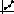

# Lab 2 – Extending a Model

## PH 212 – General Physics with Calculus

**Experimental goal: Determine whether the model for the period of a pendulum, which you tested last week, applies to large-amplitude oscillations.**

Models are not usually valid for all possible situations. In order to use a model to make predictions about real life, it’s important to know what its limitations are.

## Learning Objectives

**Learning goal: Explore and understand how data collection methods and the range over which measurements are collected impact the conclusions you can make.**

This lab activity is designed to help you practice the following skills:

1.  Design an experiment to test a hypothesis.
2.  Use available equipment to collect data in a systematic way.
3.  Fit simple functions to a data set.

## Equipment

::: action
- Computer with data analysis software (Excel, Graphical Analysis, etc.)
- Simple pendulum consisting of a mass on a light string
- Table stand, post, pendulum clamp
- Stopwatch
- Meter stick
- Protractor
- Photogate device
:::

::: box
### Graphical Analysis Pro

Graphical Analysis Pro is the software we will use to collect data. It has the advantages of accepting wireless sensors and having more curve fits than Excel.

**The software is already downloaded on lab computers.**

If you want to use Graphical Analysis Pro on your own computer, go to <https://graphicalanalysis.app>.

::: hint
- The activation code for Pro is posted on the wall of the classroom.
- You can run Graphical Analysis Pro in a Chrome browser (only Chrome), or you can run it as downloaded software.
:::
:::

## Introduction: A Risky Jump

You and your lab team have been hired to consult on a precision acrobatics show. There are many dangerous stunts in the show, requiring careful planning for safe performances. Right now, your team will evaluate an act involving a large swing with a person on it. Specifically, you must decide how the amount of time to complete a full back-and-forth motion (the period) depends on the angular displacement (amplitude) of the swing. Since we don’t have the space to set up a real swing in lab today, we will instead use a pendulum for a smaller-scale test.

::: hint
- [Helpful information:]{.underline} The appendix of this handout reviews key lessons and information from previous labs that you will find helpful for this lab and the rest of this term.
:::

## Part 1: The Model

In the previous lab, we found that a good fit for the period of a simple pendulum is proportional to the square root of the pendulum’s length. This model does not include any amplitude (angle) dependence.

The goal of today’s activity is to evaluate whether the period of a pendulum is truly independent of the amplitude (angle) of the swing. The **model** that we’re testing is:

$T = 2\pi\sqrt{\frac{L}{g}\ }$ Eq (1)

We have tested this for a small amplitude and found it to be a valid model. **We would now like to see if there really is no dependence on amplitude by testing over a wide range of angles.**

::: box
### What is a Model?

An equation and its assumptions are a **model**—a representation of physical behavior that may be expected to apply to a real system under certain conditions as stated. A model should both explain and predict physical behavior. Experiments are designed to check our understanding by testing a prediction made using the model, or *hypothesis*, of the situation.

1.  Start by using a hypothesis, or model, to make a [prediction]{.underline} about the expected behavior of a specific system. (In this activity the hypothesis is provided.)
2.  Design an experiment to check this prediction. The experiment should be designed such that the data (and subsequent analysis) can either agree or disagree with prediction.

If your results agree with your prediction, then we say that the experiment supports the hypothesis or model. If not, we say that the experiment refutes the hypothesis. All models have limitations in their applicability; experiments are the means by which we explore those limits.
:::

[In this lab the models and predictions have been provided to you.]{.underline} To test the model of Eq. (1), you will need to determine a method for precisely measuring the period of a pendulum at several different amplitudes.

## Part 2: Plan the Experiment

As stated above, the goal of today’s experiment is to test whether the model $T = 2\pi\sqrt{\frac{L}{g}\ }$ is valid for motion across a wide range of starting angles (also called amplitudes).

::: action
- As a group, plan an experiment that allows you to test whether the model is valid across a wide range of angles.
:::

::: {.question #ph212-extending-a-model:experimental-setup}
**Describe your experimental set-up. Include a clearly labeled diagram that you can use to define the variables involved. Make sure you represent the important aspects of the experiment, including angles.**
:::

::: {.question #ph212-extending-a-model:assumptions}
**Read the box below about assumptions.**

a.  **Identify at least two important assumptions required to state that your apparatus in this experiment models the real-world problem described in the introduction.**

::: box
### Assumptions:

A hypothesis typically includes assumptions about the situation being modeled. This could be ignoring the effect of a certain force (i.e. neglecting air resistance) or making some other simplification (i.e. assuming that a spring has a constant stiffness as it’s stretched).

Assumptions that are worth mentioning in a lab report should meet **two requirements**:

1.  It should be something that is not always true, but that we are claiming is true in order to simplify the interpretation of our experiment or apply our findings to another situation.
2.  It should be something that would significantly impact the *interpretation of our results* if it were not valid

In this lab for example, stating that you assume we are on Earth so g = 9.8 m/s^2^ violates requirement 1 – we are in fact on Earth – and requirement 2 – even if the value of g were different, that wouldn’t impact our ability to assess whether there is a relationship between period and initial angle of a pendulum.

You should **justify** any assumption you make **using physical reasoning**:

::: action
- Justification using physical reasonin: We assume air resistance is negligible for a falling billiard ball because it has a small surface area and is relatively heavy. (Note that this assumption would not be valid for, say, a falling piece of paper)
- Weak justification that requires verification: We assume air resistance is negligible because it makes our experiment less complicated.
:::
:::

b.  **What are the (physics-based) justifications for making these assumptions?**
:::

### Experimental design to minimize uncertainty:

For each trial, you will make one measurement of the period, which will have an associated *measurement uncertainty*.

::: action
- Identify any source(s) of uncertainty in a measurement of the [period]{.underline} (note that uncertainties in other measurements, such as in the angle, should not be included here).
:::

::: hint
- You can refer to the uncertainty information in the appendix for a list of common sources of measurement uncertainty.
:::

::: action
- If you allow the pendulum to swing more than once during a single trial, will that increase or decrease your measurement uncertainty?
- Based on this, decide how many times you’ll let the pendulum swing during each trial. If you decide to let it swing more than once, the tips below will be helpful.
  - Clicking and dragging on a graph allows you to highlight portions of it. After highlighting a portion of the data, an options menu pops up (or you can click the *Graph Tools* {width="0.1437in" height="0.1437in"} button near the bottom of the graph.
  - You can select “View Statistics” to get an info box that includes the average value and the standard deviation (uncertainty) of the highlighted data. The standard deviation within a single trial should be used as a *measurement uncertainty* for that trial.
- Estimate the size of the measurement uncertainty and write it down for later use.
- To produce a reliable result, you should repeat the measurement at the same angle multiple times. The collection of results at one angle allows you to find the *statistical uncertainty* at each angle.
:::

::: {.question #ph212-extending-a-model:procedure}
**Read the information above, then describe your experimental procedure.**

a.  **List the steps in enough detail that someone else could collect their data exactly as you did.**

::: hint
- You’ll need to measure the period at a range of different amplitudes (starting at small angles and going up to at least 60$°$. Larger amplitudes are better).
:::

b.  **Make sure to address how you will get a value for the period from each measurement.**
:::

### The role of “error” bars

Recall from the previous lab that we can never know the “true value” of a measurand (measured quantity). Error bars, more properly but virtually never called uncertainty bars, represent the uncertainty in a data point and are crucial to fully represent what we know about a measurand.

The error bars in the graph represent a range of possible values for the measurand. For two points to be confirmed as different, their error bars shouldn’t overlap – in other words, if the error bars for two measurements overlap, you cannot rule out the possibility that they are the same. To confirm that a data point deviates from your expectations, the full range of its error bars should be outside your expectation.

::: {.question #ph212-extending-a-model:analysis-plan}
**Read the paragraph above about error bars. Then plan your analysis. Describe how you will use your data to check if there is a relationship between starting amplitude and period.**
:::

::: hint
- **Remember, *we are predicting that there is no relationship between period and angle*. What can you look for in your data that might suggest there really is a relationship?**
:::

## Part 3: Collect Data

Perform your experiment and record your data. This should include the value and uncertainty of each measurement at each angle. If you did multiple runs at each angle this will include an average and statistical uncertainty.

::: hint
- Hint: If you use the photogate, set the mode to “Timer or Period” in Graphical Analysis. Check with your instructor if you need help.
:::

::: {.question #ph212-extending-a-model:report-data}
**Report your data:**

a.  **Calculate the total uncertainty at each angle $\Delta T_{\text{total}}$ by adding the measurement and statistical uncertainties in quadrature.**

    $$\Delta T_{\text{total}} = \sqrt{\left( \Delta T_{m} \right)^{2} + \left( \Delta T_{s} \right)^{2}}$$

b.  **Include a data table representing your entire experiment, with column labels and units, and the total uncertainty values for each angle.**
:::

## Part 4: Analyze the Data

Now, plot the data that you collected.

::: {.question #ph212-extending-a-model:perform-analysis}
**Perform the analysis that you planned previously. Include any graphs you make, with all the required elements. Add the total uncertainty to your plot as error bars – make sure to adjust the size to match the actual values of uncertainty you found.**
:::

::: hint
- See the appendix at the end of this handout if you need a reminder of what you should include in a graph.
:::

## Part 5: Reflect and Conclude

This activity is meant to show how an experiment tests a hypothesis or model by checking a prediction. You should now have a graph you can use to evaluate the model.

Discuss the questions below with your group and provide a single answer you all agree on. Making a recommendation is the ultimate goal of your experiment!

::: {.question #ph212-extending-a-model:conclusions}
**Draw conclusions from your analysis:**

a.  **Based on this experiment, state your conclusion about whether the period is in fact independent of angle. Justify it using quantitative evidence from your analysis, including uncertainty.**
b.  **If you’re claiming that period *is* dependent on angle, propose a mathematical model (equation) that describes the relationship well. Justify your proposed model using quantitative evidence.**
:::

::: {.question #ph212-extending-a-model:range-and-precision}
**How did the range over which you collected your measurements and the precision of your data collection methods impact the conclusions you were able to draw? Reflect on limitations you encountered (if any) and how different approaches might have altered your results.**
:::

::: {.question #ph212-extending-a-model:recommendation}
**In the act, the performer plans to swing at a maximum amplitude of 60º. Based on your results, would you recommend they use the model given by Eq. (1) or should they use a different one to ensure their safety? Justify your recommendation.**
:::

## Part 6: Submit Your Group’s Lab Report

Make sure everyone’s name is on your group’s lab report. If you submit through Gradescope remember to add everyone in your group to the assignment. This is done at the end of the submission process.

## Appendix: Reference Information

This section contains key information from previous labs.

1.  Required Plot Elements
2.  What Is Uncertainty?
3.  Sources of Uncertainty
4.  Linearization

### Required Plot Elements

::: action
- Do not connect the data points with lines.
- Make sure you create *Scatter Plots* and not *Line Plots*.
- Evaluate if the plot makes sense. Are the axes correct? Do you have the right number of data points?
- Include a descriptive title and labels on each axis, always including physical units.
- Add a legend, unless you only have one set of data and the title describes it.
- Display the equation and R^2^ value for any trendline you include.
:::

### What is Uncertainty?

*Uncertainty* is the acknowledgement that we cannot measure things exactly, and so any conclusion based on measurements will always include a range of possible answers. When making a measurement, there is no single “true value” of the measurand (measured quantity) that we can determine. Instead, we can define an interval that defines the range of values that we think are *probable* for the measurand. The narrower the interval, the more precisely we can approximate the measurand.

When including uncertainty in a value, we report it as **A ± Δ~A~**. We believe the value is **A**, but we’re unable to rule out the possibility that it’s higher or lower by an amount **Δ~A~**. (Sometimes it’s written +Δ~1~ / -Δ~2~ if the higher and lower ranges are different.) For example, a time might be reported as 2.45 s ± 0.03 s.

### Sources of Uncertainty

The uncertainty in a measurement can be due to a combination of several factors. A crucial aspect of experimentation is to identify all such sources of uncertainty and to numerically estimate their effect on your measurement result.

Common sources of uncertainty include:

1.  your judgement in reading analogue instruments
2.  the effects of environmental conditions on the measurement
3.  the sensitivity of your instruments (e.g. a digital scale, a meter stick)
4.  the rating or stated calibration of the instrument
5.  approximations and assumptions that you make while doing the experiment
6.  variations in repeated readings made under apparently identical conditions (statistical uncertainty)

A measurement uncertainty is not meant to be an indication of “mistakes” that you might make in an experiment. If you are aware that you have made a mistake, then you should repeat your experiment. **“Human error” is not a valid source of uncertainty**. If you know that you did something “wrong”, then the right course of action is to redo it correctly.

### Linearization

In the context of data analysis, “linear” refers to a directly proportional relationship between the dependent and independent variables in an equation.

::: hint
- Mathematically, if two variables $x$ and $y$ have a linear relationship, we can express this as $y = mx + b$ where m and b are constants.
- More simply, we can write this as $y \propto x$ where $\propto$ means “is proportional to”.
- When graphed, data with a linear relationship falls on a straight line.
:::

**Linearization comes in handy when your data or hypothesis is *not* linear.**

When you fit data with a linear trendline, you are essentially checking whether the two variables are proportional to each other. To check a nonlinear hypothesis, can we instead check if one variable is proportional to *a function of* the other variable.

In practice, **linearization is done by calculating a new column of data,** that gives the values of a *function* of the input variable. Typically, the input variable is the independent variable, and the function is chosen so that the resulting quantity is proportional to the dependent variable.

**Why Linearize?**

::: action
- Linear data is typically easier to understand and analyze.
- There are analysis methods we can apply to linear data that don’t work as well (or at all) with nonlinear data.
- It is relatively easy to fit a line to data - there are just two important values to determine: the slope and intercept of the data.
:::
