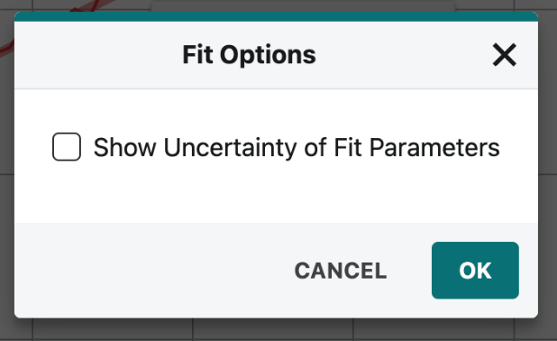
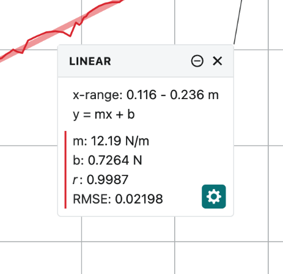

# Lab 5 – Sharing & Comparing

## PH212 – General Physics with Calculus

**Experimental goal: Find the linear mass density of a string using standing waves on the string.**

After any scientific experiment, we rely on comparison to the results that others obtain to validate our own. In this lab activity, you will compare your results with your classmates’ and use the uncertainty ranges to determine whether they agree.

## Learning Objectives

**Learning goal: Find an experimental value for a parameter in a model and learn how to propagate uncertainty from measured values to a calculated value.**

This lab activity is designed to help you practice the following skills:

1.  Choose an appropriate model of a physical system to be tested.
2.  Linearize data and fit simple functions to data sets.
3.  Understand the relationship between measured quantities and parameters of interest.
4.  Use uncertainty ranges to determine if two or more values agree.

## Equipment

::: action
- Oscillator
- Frequency generator
- String
- Pulley
- Masses & hanger
- Meter stick
:::

## Part 1: Build a Model

Create a model with the equation you will use to find the linear mass density of the string. It will help to recall the following about waves in general and standing waves in particular:

::: hint
- Waves are created by an oscillator, and the wave frequency is the same as the oscillator frequency.
- The speed of waves on a string is given by $\mathbf{v =}\sqrt{\mathbf{T}_{\mathbf{S}}\mathbf{/\mu}}$ , where *T~S~* is the tension in the string and *µ* is its linear mass density (or just mass density).
- On a string with two fixed ends, you can generate a series of standing waves of different wavelengths ***λ~n~ = 2L/n**,* where *L* is the length of the string and *n* is any positive integer. (“*n*” is the *mode* of the standing wave, and counts the number of anti-nodes, or maxima.)
- Speed has the same relationship to the frequency and wavelength for standing waves as for traveling waves: ***v = f~n~** **λ~n~***.
:::

::: {.question #ph212-sharing-and-comparing:combine-wave-equations}
**Start by combining the equations above to find one equation that relates string density, frequency, and wavelength. Your equation should depend only on easily measurable quantities based on the given lab equipment. You may have to apply multiple ideas about waves and waves on strings to find a suitable expression.**
:::

::: hint
- **Your instructor may decide to do this as a class.**
:::

## Part 2: Plan your Experiment

You now will need to decide on the dependent and independent variables. Recall that the independent variable is the quantity that you can select a particular value for, and the dependent variable is the measured quantity that you don’t have arbitrary control over.

In this experiment there are three variables: The hanging mass, the frequency, and the mode number. Choose *one* that you will vary in a controlled way – your independent variable. Choose another that you will measure – your dependent variable. The third is a parameter of the experiment and should stay constant*.*

::: hint
- You can vary the tension by changing the mass hanging on the string.
- You can vary the frequency of oscillations using the frequency generator.
- You can look for standing waves of different modes as you vary your independent variable. Or you can work with just one mode and look for combinations of variables that create that mode.
:::

You will change the independent variable to create a standing wave, and then record the value of the independent and dependent variables. Do this for a range of independent variables, so that you have enough pairs to create a graph.

Note that you will need to determine the measurement and statistical uncertainties in whatever you choose for the dependent variable.

::: {.question #ph212-sharing-and-comparing:identify-variables}
**Decide what you want to vary and record, that is, identify the independent and dependent variables. Also identify the parameters in the system, those quantities which will be constant throughout your experiments?**
:::

::: hint
- Remember, everything that changes is a variable. This includes mode number. You need to decide if it’s independent (directly controlled) or dependent (changing in response to changes in the independent variable).
- Everything that doesn’t change is a parameter. This includes the mass density, but that’s not the only parameter!
:::

### Rearrange your equation:

::: action
- Rearrange your model equation to the form
:::

*(Dependent variable) = (Parameters) \* (Independent variable) + (Other)*

Note that the mass density will be one of the parameters in your equation.

*Design a reliable experiment to find the mass density of the string, based on your rearranged equation and using the available equipment.*

::: hint
- Hint: Graphing the dependent vs. independent variable such that the expected curve is linear can be a useful method for extracting the mass density.
:::

::: {.question #ph212-sharing-and-comparing:rearranged-equation}
**Record the rearranged equation in your report. Describe the experiment you will do.**

a.  **The description should include how you will vary your independent variable and measure your dependent variable.**
b.  **Describe your proposed analysis. This will be based on your rearranged equation. Remember that, when possible, we want to use plots to find values. So your proposed analysis should include using a graph to find the mass density.**
:::

**\*\*\*Verify your model equation and experimental design with your instructor\*\*\***

## Part 3: Collect Data

Now you’re ready to run your experiment. Remember that good experiments involve many trials, not just one or two.

::: {.question #ph212-sharing-and-comparing:perform-experiment}
**Perform your experiment, recording your data in an organized and easily understandable form. Include a sketch of each mode that you find. If you change the mode, find as many as possible. If you work with one mode, find a wide range of frequency and mass pairs that make a standing wave. While taking data, make sure you are also considering uncertainty, outlined in the question below.**
:::

### Tips when searching for standing waves:

::: hint
- Go slowly and in small steps. It can take time for the wave to stabilize on the string. This is especially true when varying frequency.
- When you get to a suspected standing wave, try small variations in either direction. Look for sharper nodes, larger antinodes, and less vibration at the oscillator.
- Once you find one standing wave, let its parameters guide you to others.
:::

::: {.question #ph212-sharing-and-comparing:measurement-uncertainty}
**We also want to consider the uncertainty in our measurements. One way that we can estimate the measurement uncertainty is by looking at the range of values of the variables that still reasonably give the same standing wave pattern. (You should be doing this while recording data, outlined in the question above.)**

a.  **Using this method, what is the uncertainty in your dependent variable? (If your dependent variable is the mode number *n*, state this and go on to the next part.)**
b.  **What is the uncertainty in your other measured values, including measured parameters?**
:::

## Part 4: Analyze the Data and Draw Conclusions

You should now be ready to use your data to determine the quantity of interest – the linear mass density of your string. Remember, when finding the value of a quantity, it is usually better to find a single value that takes into account all of your data, instead of finding many values and averaging them. Graphing is often the best way to do this.

::: {.question #ph212-sharing-and-comparing:mass-density-analysis}
**Perform your analysis to find the mass density of the string. If you use a graph, attach it here, describe what it shows, and explain how you used it to find the mass density.**
:::

::: box
**[Propagating Uncertainty]{.underline}**

We would also like to be able to report the uncertainty in the mass density. There is an equation that we can use to calculate the total uncertainty in a quantity that depends on several other quantities, each with its own uncertainty.

Suppose the quantity $w\ $depends on three other quantities $x,\ y,\ z$, such that $w = \frac{x^{\alpha}y^{\beta}}{z^{\gamma}}$. Each measured quantity has its own uncertainty, $\Delta x,\ \Delta y,\ \Delta z$. Then the uncertainty in $w$ is given by the equation:

$$\Delta w = w*\sqrt{{\alpha\left( \frac{\Delta x}{x} \right)}^{2} + {\beta\left( \frac{\Delta y}{y} \right)}^{2} + {\gamma\left( \frac{\Delta z}{z} \right)}^{2}\ }$$

You might notice that this looks very similar to the equation you have been using to find total uncertainty from multiple sources, with a few important changes.

::: hint
- Each quantity may have different units; by dividing each uncertainty by the measured value everything in the square root is unitless. You can also think of this as adding the percent uncertainties together (also called relative uncertainty), instead of the uncertainties themselves.
- Exponents are just repeated multiplication – for example, $x^{2} = x*x$. In this case, the uncertainty in $x$ would come up twice in the square root, so we would add $\left( \frac{\Delta x}{x} \right)^{2} + \left( \frac{\Delta x}{x} \right)^{2} = 2\left( \frac{\Delta x}{x} \right)^{2}$, which is why exponents become multiplication factors.
:::
:::

::: {.question #ph212-sharing-and-comparing:uncertainty-expression}
**Starting from the expression you used to find the mass density, write a symbolic expression for the uncertainty in the mass density in the form of the equation above. Use this equation to calculate the uncertainty in the mass density of the string.**
:::

## Part 5: Discuss Results

Your instructor will give you some time to prepare a whiteboard. They may also collect your results to put on the front board. After every group has their whiteboard ready, there will be time to report out and discuss results. Your whiteboard should include:

1.  The names of all group members and your table number.
2.  A short summary of your experimental method. (About two sentences). This should include information about what quantities you varied, and what the values of any relevant fixed parameters were.
3.  A sketch of the graph of your data
4.  The measured value of the mass density for your string.

Be ready to answer the following question in your lab report after the discussion:

::: {.question #ph212-sharing-and-comparing:groups-agree}
**Did the results from every group agree? How might you explain any significant differences between results? (Think about what is meant by significant.)**
:::

## Part 6: Submit Your Group’s Lab Report

Make sure everyone’s name is on your group’s lab report. If you submit through Gradescope remember to add everyone in your group to the assignment. This is done at the end of the submission process.

## Appendix – Reference Information

This section contains key information from previous labs.

1.  Required Plot Elements
2.  What Is Uncertainty?
3.  Sources of Uncertainty
4.  Linearization
5.  Assumptions
6.  Designing a reliable experiment
7.  Finding uncertainty in a slope

### Required Plot Elements

::: action
- Do not connect the data points with lines.
- Make sure you create *Scatter Plots* and not *Line Plots*.
- Evaluate if the plot makes sense. Are the axes correct? Do you have the right number of data points?
- Include a descriptive title and labels on each axis, always including physical units.
- Add a legend, unless you only have one set of data and the title describes it.
- Display the equation and R^2^ value for any trendline you include.
:::

### What is Uncertainty?

*Uncertainty* is the acknowledgement that we cannot measure things exactly, and so any conclusion based on measurements will always include a range of possible answers. When making a measurement, there is no single “true value” of the measurand (measured quantity) that we can determine. Instead, we can define an interval that defines the range of values that we think are *probable* for the measurand. The narrower the interval, the more precisely we can approximate the measurand.

When including uncertainty in a value, we report it as **A ± Δ~A~**. We believe the value is **A**, but we’re unable to rule out the possibility that it’s higher or lower by an amount **Δ~A~**. (Sometimes it’s written +Δ~1~ / -Δ~2~ if the higher and lower ranges are different.) For example, a time might be reported as 2.45 s ± 0.03 s.

### Sources of Uncertainty

The uncertainty in a measurement can be due to a combination of several factors. A crucial aspect of experimentation is to identify all such sources of uncertainty and to numerically estimate their effect on your measurement result.

Common sources of uncertainty include:

1.  your judgement in reading analogue instruments
2.  the effects of environmental conditions on the measurement
3.  the sensitivity of your instruments (e.g. a digital scale, a meter stick)
4.  the rating or stated calibration of the instrument
5.  approximations and assumptions that you make while doing the experiment
6.  variations in repeated readings made under apparently identical conditions (statistical uncertainty)

A measurement uncertainty is not meant to be an indication of “mistakes” that you might make in an experiment. If you are aware that you have made a mistake, then you should repeat your experiment. **“Human error” is not a valid source of uncertainty**. If you know that you did something “wrong”, then the right course of action is to redo it correctly.

### Linearization

In the context of data analysis, “linear” refers to a directly proportional relationship between the dependent and independent variables in an equation.

::: hint
- Mathematically, if two variables $x$ and $y$ have a linear relationship, we can express this as $y = mx + b$ where m and b are constants.
- More simply, we can write this as $y \propto x$ where $\propto$ means “is proportional to”.
- When graphed, data with a linear relationship falls on a straight line.
:::

**Linearization comes in handy when your data or hypothesis is *not* linear.**

When you fit data with a linear trendline, you are essentially checking whether the two variables are proportional to each other. To check a nonlinear hypothesis, can we instead check if one variable is proportional to *a function of* the other variable.

In practice, **linearization is done by calculating a new column of data,** that gives the values of a *function* of the input variable. Typically, the input variable is the independent variable, and the function is chosen so that the resulting quantity is proportional to the dependent variable.

### Why Linearize?

::: action
- Linear data is typically easier to understand and analyze.
- There are analysis methods we can apply to linear data that don’t work as well (or at all) with nonlinear data.
- It is relatively easy to fit a line to data - there are just two important values to determine: the slope and intercept of the data.
:::

### Assumptions

A hypothesis typically includes assumptions about the situation being modeled. This could be ignoring a force or assuming it’s constant, or making some other simplification.

For example:

::: action
- In free fall, we assume air resistance is negligible (so small that its effects can be ignored).
- Hooke’s law assumes the elasticity of a spring is constant – the spring constant.
- Calculations of Earth’s gravity may assume a perfectly spherical planet.
:::

These assumptions may or may not be justified. For example:

::: action
- A billiard ball on Earth falls for at least short distances with an acceleration of g, the same as in a vacuum, as if there were no air. Assuming air resistance is negligible is valid when considering its motion.
- A sheet of paper falls much more slowly. The assumption that air resistance is negligible is not valid – predictions made from a model that ignores air resistance will not match what is observed.
:::

Identifying, justifying, and checking assumptions is an important part of an experiment.

**[In a reliable scientific experiment, you should:]{.underline}**

::: action
- Perform multiple trials, in which you repeat the same experiment, taking data each time.
- Identify the quantity or quantities to measure – the dependent variables.
- Identify the quantity to control and change – the independent variable. A good experiment changes only one quantity at a time, so that it’s clear what causes any changes to the de-pendent variables.
- Identify the quantities to be held constant. These are the things that shouldn’t be changed from trial to trial so that you can expect the same outcome each time. While your outcome will in fact vary, if you’ve done a good job here the variations should be small. (Large variations are often a sign of something unexpected.)
- Describe your experimental set-up, explaining what is held constant, how you’ll vary the dependent variable(s), and what independent variable you’ll measure. Often, this will include a well-labeled diagram.
:::

### Finding uncertainty in a slope:

1.  Using Excel: Type the function shown below into a cell in your Excel spreadsheet.

=LINEST(*y-data range*, *x-data range*, TRUE, TRUE)

{width="3.2028in" height="1.4833in" crop="0 3262 0 0"}

The function outputs two columns of values. The uncertainty in the slope is the second box down in the left column.

{width="2.8705in" height="1.3083in"}

5.  Using Graphical Analysis: Highlight the data on the plot and select “Apply Fit”, then hit the options button and select the “Display Fit Parameters” box.{width="2.8097in" height="1.7194in"}{width="1.7089in" height="1.6197in" crop="10822 9940 7992 10517"}
