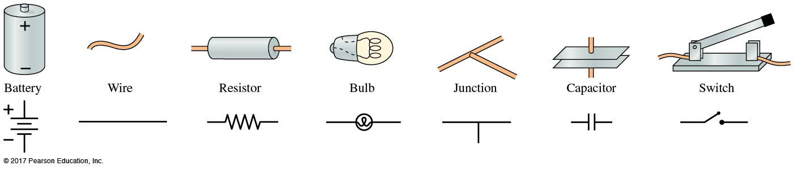
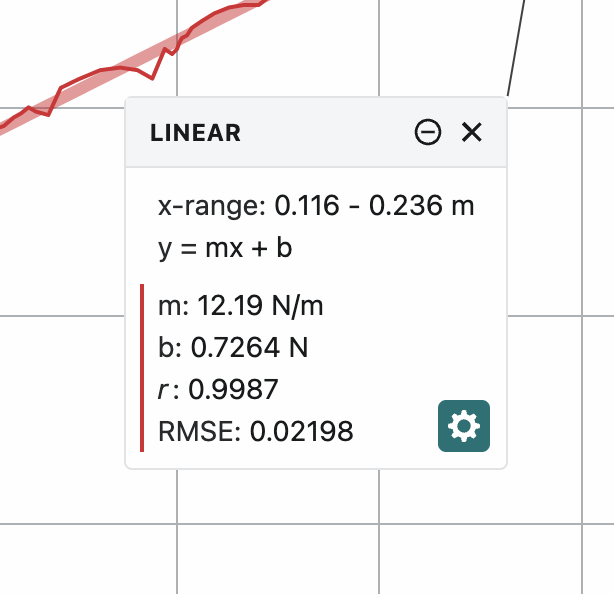
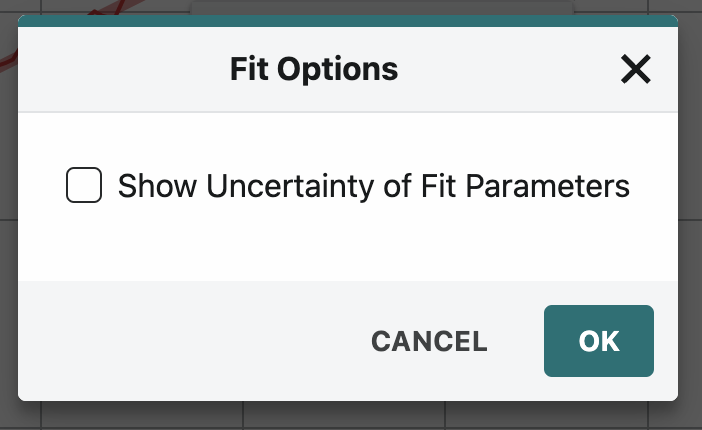

# Lab 5 – Analysis and Testing

## PH 213 – General Physics with Calculus

**Experimental goal: Determine the resistance of components over a range of currents and voltages to see whether or not they’re ohmic.**

The fundamental relationship among the three important electrical quantities current, voltage, and resistance was discovered by Georg Simon Ohm. (You may recognize his name as the unit of resistance.) In this lab, you will discover this relationship for yourself!

## Learning Objectives

**Learning goal: Analyze data using plots and fits to test a model for different types of electrical components.**

This activity was designed to help you practice the following skills:

1.  Identify independent and dependent variables and choose parameters to hold constant.
2.  Fit simple functions to data sets and extract physical parameters from the fit.
3.  Use uncertainty ranges to determine if two or more values agree.
4.  Use a model and experimental results to predict an outcome.

## Equipment

::: action
- Power supply
- Spring board and wires for creating circuits
- Resistors and bulbs for testing
- Wireless voltage to use with Graphical Analysis
- Wired current probes to use with Graphical Analysis
:::

## Circuits Background

One obstacle to understanding current and voltage is that they cannot be sensed directly. To clarify these terms, some people make the comparison between electrical circuits and water flowing in pipes. Here is a chart of the three electrical units we will study in this experiment and their analogous quantities in water flow. You may find it useful to think in terms of water flow as your working through the activities, so we provide an analogy with water flow.

| Electrical Quantity | Description | Unit | Water Analogy |
|:-----------------|:-------------------------------------------------|:-----------|:-----------------|
| Voltage or Potential Difference | A measure of the energy difference per unit charge between two points in a circuit – the “push” a charge receives as it goes from the first point to the second. | Volt (V) | Water Pressure (psi) |
| Current | The rate at which charge flows in a circuit – how much charge passes a point in a given time. | Ampere (A) | Flow rate (gallons per minute) |
| Resistance | A measure of how difficult it is for current to flow in a circuit. **It is the ratio of the “push” (voltage) to “flow” (current).** | Ohm (Ω) = 1 V/A | Resistance to flow / viscosity. |

::: hint
- If the resistance of the component stays constant as the voltage and current change, we say that the component is *ohmic*.
- If it changes, we say the component is *non-ohmic*.
:::

**In this activity you will determine the resistance of components over a range of currents and voltages to see whether or not they’re ohmic.**

## Representing Circuits

This activity will require you to work with electrical circuits. Rather than making a physical sketch of the situation, it is more useful to represent your circuit as a *schematic circuit diagram* (often referred to as simply a “circuit diagram” or sometimes a “schematic”). This is an electrical representation that focuses on how the components are electrically connected without regard to the physical location or orientation. It is much easier to interpret the electrical behavior of a circuit from a circuit diagram.

In circuit diagrams, the components are represented by standard symbols. Examples are shown below. The symbols are laid out on a grid (usually rectangular). Wire connections are shown as straight lines that make turns at right angles. Lines that meet indicate a connection between wires, or a junction.

{width="6.4043in" height="1.3750in"}

## Helpful Hints

::: hint
- Make sure the power supply is turned off before building a circuit.
- A circuit starts at the positive terminal of a source (such as the power supply), runs continuously through the component in the circuit (like a resistor or bulb), and ends back at the negative terminal of the source. Along the way it can have branches and include multiple components, but each component must be part of a continuous loop that includes the supply.
- Circuit connections can be made on the spring board by gently bending or stretching the springs and placing a wire or component between the coils. Do not wrap around the springs.
- You can attach multiple wires to the same spring to create a *junction* of connections.
- All wires are the same. The different colors are to help keep track of wires in the circuit. If a particular color is specified, it’s so that wire can be referenced later on.
- The power supply can be connected to the circuit using the terminals along the edge of the spring board.
- The red and black connections on the probes are different. Reversing them will reverse the sign of the quantity being measured.
- If you’re unsure about any connections, ask your instructor. It’s important to have the correct wiring before turning on power.
:::

## Part 1: Measure and Relate Voltage and Current

**[Set up data collection]{.underline}**

We will use probes with Graphical Analysis (GA) to monitor the values of voltage and current. Check that the current probe is connected to the LabQuest mini and the voltage probe is on and ready to connect, and then open GA.

::: action
- The app should default to showing two graphs, one for voltage and one for current, each as a function of time.
- The lower right corner of the display should show the constantly updated values of current and voltage detected by the sensors.
- You should zero the sensors by clicking on the displayed value and choosing “Zero” from the menu.
:::

The GA default is not how you want to record data. You want to choose when GA collects data, instead of letting it collect continuously for a period of time. To set up Graphical Analysis:

1.  Click on the *Mode* box in the lower left corner.
2.  From the window that opens, click on the *Mode* box and choose *Event Based.*
3.  Under Event Mode, choose Selected Events

    a.  The display will change to show a graph of Potential vs. Event. (Potential is equivalent to voltage.)
    b.  Graphical Analysis will take a data point and display it on the graph each time you hit the spacebar.

4.  Finally, change the x-axis to show Current by clicking on it.

### Create a circuit

Start by building a simple circuit on the spring board consisting of the power supply and either one of your two resistors.

Helpful notes about creating circuits:

::: hint
- The leads (wires) from the power supply can be plugged into a like-colored post on the spring board.
- If you unscrew the post slightly, you’ll see a hole in the post. You can attach a wire to the post by inserting a wire in the hole. Running that wire to spring terminal allows you to connect the power supply to other components.
:::

::: {.question #ph213-analysis-and-testing:circuit-diagram}
**Draw a clearly labeled *circuit* diagram of your configuration using the symbols in Figure 1. The power supply can be represented as a battery. Be clear about the positive and negative orientations of each item. Add the probes to measure voltage across the resistor and current through the resistor to your circuit diagram, and then add the diagram to your report.**
:::

Hints for adding probes:

::: hint
- You want to measure the voltage *across* the resistor (from one side to the other).
- You want to measure the current *through* the resistor, measuring all the charge flow that goes into or out of the resistor.
:::

Once you are confident that your circuit is correctly constructed (you can check with your instructor), try the following to apply power:

1.  Make sure the voltage knob on the power supply is turned all the way down (counterclockwise).
2.  Turn on the power supply.
3.  Slowly turn up the voltage while monitoring the voltage and current in Graphical Analysis. Check the displays in Graphical Analysis to make sure they are increasing.

### Collect data for one resistor

Turn off the power and reset the voltage to zero. You can now apply power and take data using the method you chose. Your goal is to explore the relationship between voltage and current for the resistor.

::: {.question #ph213-analysis-and-testing:data-table}
**Create a clearly labeled data table of your current and voltage data. This can be a screenshot of Graphical Analysis. Include the data table in your report.**

a.  **Estimate the measurement uncertainty for the current and voltage data. Be sure to explain the source(s) of measurement uncertainty.**
:::

Once you have your data, use it to answer the following questions.

::: {.question #ph213-analysis-and-testing:voltage-current-relationship}
**Based on the plot of your data, what is the relationship between voltage and current? Fit your data and use the result to write an equation giving voltage in terms of current. What feature of the graph allows you to find the resistance?**
:::

::: hint
- Graphical Analysis can provide uncertainty in the fit parameters. On the window with the results of your curve fit, click on the gear icon in the lower right corner to open the settings and select “Show Uncertainty of Fit Parameters.” Graphical Analysis Pro must be activated in order to use this feature.
:::

::: {.question #ph213-analysis-and-testing:resistor-resistance}
**Based on your data, what is the resistance of your resistor? Compare your result to the stated resistance. Is your measured value for the resistor within the range of acceptable resistance?**
:::

::: hint
- You can determine the stated resistance of the resistor using the colored bands. (Refer to the chart in your room or ask your instructor for help.)
- Resistors are manufactured such that their actual resistance is within a certain range, or tolerance. For the resistors used in this lab the tolerance is 5%, meaning the actual resistance may be as much as 5% above or 5% below the stated value.
:::

## Part 2: Apply your Results

**[Check your equation]{.underline}**

Replace the resistor in your circuit with one that has a different value. Take measurements of voltage and current. See if the results you found for the first resistor apply in this case.

::: {.question #ph213-analysis-and-testing:second-resistor}
**Based on your data, what is the resistance of your second resistor? Compare your result to the stated resistance. Is your measured value for the resistor within the range of acceptable resistance? What does this say about the validity of your results in general?**
:::

**[Explore the validity of your equation]{.underline}**

Replace the resistor in your circuit with the incandescent bulb. Collect data on the relationship between the bulb voltage and current to see if your method applies in this case. Explore the same range of voltage as you did for the resistors.

[Important:]{.underline} Be sure to record several points **below 1 V (low voltage)**, and several **above 12 volts (high voltage)**. (Several means at least three, but more is better.)

::: {.question #ph213-analysis-and-testing:turn-up-voltage}
**What happens as you turn up the voltage? Focus not only on your data, but also on the circuit itself.**
:::

::: {.question #ph213-analysis-and-testing:bulb-versus-resistor}
**How does the graph for the bulb differ from that for the resistor? What does this tell you about the resistance of the bulb? Would you say that the lightbulb is Ohmic? Attach your graph(s) for the bulb to your report.**
:::

::: {.question #ph213-analysis-and-testing:bulb-resistance}
**Determine the resistance of the bulb at a low voltage and at a high voltage. What was the resistance at low voltage, and what were the voltage and current at that point? What was the resistance at high voltage, and what were the voltage and current at that point?**
:::

::: {.question #ph213-analysis-and-testing:resistance-behavior}
**Propose a possible reason for the observed behavior of the resistance as you changed the voltage. You will likely be speculating about the cause of an observed behavior. Base your speculations as much as possible on your knowledge of resistance, materials, circuits, etc.**
:::

Such informed speculation is an important part of using experiment to advance science.

## Part 3: Submit your Group’s Lab Report

Make sure everyone’s name is on your group’s lab report. If you submit through Gradescope remember to add everyone in your group to the assignment. This is done at the end of the submission process.

## Appendix – Reference Information

This section contains key information from previous labs:

1.  Required Plot Elements
2.  Linearization
3.  Uncertainty
4.  Propagating Uncertainty
5.  Finding Uncertainty in a Slope

**[Required Plot Elements]{.underline}**

::: action
- Do not connect the data points with lines.
- Make sure you create *Scatter Plots* and not *Line Plots*.
- Evaluate if the plot makes sense. Are the axes correct? Do you have the right number of data points?
- Include a descriptive title and labels on each axis, always including physical units.
- Add a legend, unless you only have one set of data and the title describes it.
- Display the equation and R^2^ value for any trendline you include.
:::

**[Linearization]{.underline}**

In the context of data analysis, “linear” refers to a directly proportional relationship between the dependent and independent variables in an equation.

::: action
- Mathematically, if two variables $x$ and $y$ have a linear relationship, we can express this as $y = mx + b$ where m and b are constants.
- More simply, we can write this as $y \propto x$ where $\propto$ means “is proportional to”.
- When graphed, data with a linear relationship falls on a straight line.
:::

**Linearization comes in handy when your data or hypothesis is *not* linear.**

When you fit data with a linear trendline, you are essentially checking whether the two variables are proportional to each other. To check a nonlinear hypothesis, can we instead check if one variable is proportional to *a function of* the other variable.

In practice, **linearization is done by calculating a new column of data** that gives the values of a function of the input variable (you will practice this below, so don’t worry if you don’t understand what this means yet). Then, the linearized data can be plotted and analyzed.

**[Why Linearize?]{.underline}**

::: action
- Linear data is typically easier to understand and analyze.
- There are analysis methods we can apply to linear data that don’t work as well (or at all) with nonlinear data.
- It is relatively easy to fit a line to data - there are just two important values to determine: the slope and intercept of the data.
:::

**[Sources of Uncertainty:]{.underline}**

The uncertainty in a measurement can be due to a combination of several factors. A crucial aspect of experimentation is to identify all such sources of uncertainty and to numerically estimate their effect on your measurement result.

Common sources of uncertainty include:

1.  your judgement in reading analogue instruments

<!-- -->

1.  the effects of environmental conditions on the measurement
2.  the sensitivity of your instruments (e.g. a digital scale, a meter stick)
3.  the rating or stated calibration of the instrument
4.  approximations and assumptions that you make while doing the experiment
5.  variations in repeated readings made under apparently identical conditions (statistical uncertainty)

A measurement uncertainty is not meant to be an indication of “mistakes” that you might make in an experiment. If you are aware that you have made a mistake, then you should repeat your experiment. **“Human error” is not a valid source of uncertainty**. If you know that you did something “wrong”, then the right course of action is to redo it correctly.

When a measurement has multiple sources of uncertainty, we can combine them by:

$$\Delta t_{total} = \sqrt{\left( \Delta t_{1} \right)^{2} + \ \left( \Delta t_{2} \right)^{2} + \ \left( \Delta t_{3} \right)^{2} + \ldots}$$

This is called *adding in quadrature*.

**[Uncertainty in a Calculated Quantity (Propagating Uncertainty)]{.underline}**

Suppose we have a quantity $w\ $that depends on three other quantities $x,\ y,\ z$, such that $w = \frac{x^{\alpha}y^{\beta}}{z^{\gamma}}$. Each measured quantity has its own uncertainty, $\Delta x,\ \Delta y,\ \Delta z$. Then the uncertainty in $w$ is given by the equation:

$$\Delta w = w*\sqrt{{\alpha\left( \frac{\Delta x}{x} \right)}^{2} + {\beta\left( \frac{\Delta y}{y} \right)}^{2} + {\gamma\left( \frac{\Delta z}{z} \right)}^{2}\ }$$

This is very similar to the equation used to find total uncertainty from multiple sources, with a few important changes.

Each quantity likely has different units, so by dividing each uncertainty by the measured value, everything in the square root is unitless. You can also think of this as adding the percent uncertainties together (also called relative uncertainty), instead of the uncertainties themselves.

Exponents are just repeated multiplication – for example, $x^{2} = x*x$. In this case, the uncertainty in $x$ would come up twice in the square root, so we would add $\left( \frac{\Delta x}{x} \right)^{2} + \left( \frac{\Delta x}{x} \right)^{2} = 2\left( \frac{\Delta x}{x} \right)^{2}$, which is why exponents become multiplication factors.

### Finding uncertainty in a slope:

Type the function shown below into a cell in your Excel spreadsheet.

{width="3.2076in" height="1.4812in" crop="0 3262 0 0"}

The function outputs two columns of values. The uncertainty in the slope is the second box down in the left column.

{width="2.8771in" height="1.3111in"}

When using Graphical Analysis, adding uncertainty to fit parameters is an option after performing a curve fit. Clicking on the gear icon on the curve fit opens the Fit Options menu, where uncertainty in fit parameters can be added.{width="1.7090in" height="1.6194in" crop="10822 9940 7993 10516"}{width="2.8097in" height="1.7201in"}
