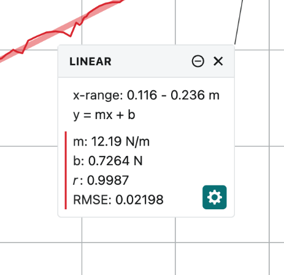
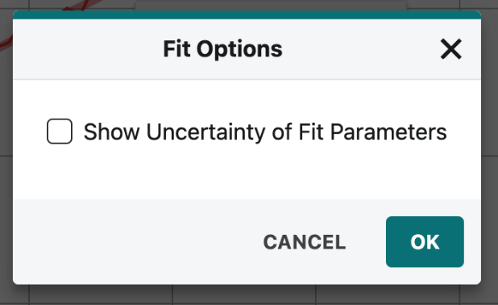

# PH 213 Capstone Project

### PH213 – General Physics with Calculus

**Experimental goal: Choose a physical phenomenon to investigate and develop a model to describe it. Then design, execute, and analyze an experiment to test the model.**

Overview of this multi-week lab

::: action
- In the first class you will compare your idea with those of your classmates to form a lab group and explore ways of taking data.
- In the second class you will complete your chosen experiment.
- In the final class each group will share a brief presentation on what they did.
:::

### Learning Objectives

**Learning goal: Put all the skills you learned this term into practice and experience one full cycle of the scientific process. Communicate your findings with your peers.**

This activity is designed to help you practice the following skills:

1.  Create a research question and design an experiment to test possible answers.
2.  Run and analyze an experiment to reach a conclusion on a proposed question.
3.  Explain the experiment, broader context, and uniqueness of the investigation in an oral presentation.

### Table of Contents (Ctrl-click on the title to jump to that section)

- **[Rubric](#rubric)**
- **[Week 1 – Design Your Experiment](#week-1-design-your-experiment)**
  - **[Before Lab](#before-lab)**
  - **[In Lab](#in-lab)**
- **[Week 2 – Perform Your Experiment](#week-2-perform-your-experiment)**
- **[Week 3 – Present Your Results](#week-3-present-your-results)**
  - **[Before Lab](#before-lab-1)**
  - **[In Lab](#in-lab-1)**
- **[APPENDIX A: Choosing an Experiment](#appendix-a-choosing-an-experiment)**
- **[APPENDIX B: List of Previous Labs in the PH 21X Curriculum](#appendix-b-list-of-previous-labs-in-the-ph-21x-curriculum)**
- **[APPENDIX C: List of Available Equipment](#appendix-c-list-of-available-equipment)**

::: landscape
### Rubric

Responses are assessed using the following guidelines, with no response to a question earning no points.

| Objective | 1 | 2 | 3 | 4 |
|:------------|:----------------------------|:----------------------------|:----------------------------|:----------------------------|
| Describe your experiment | Model and research question are unclear. | Describes model, with some research question implied. | Describes model, including essential variables to investigate. A research question and prediction(s) are implied. | Describes model, including equations and essential variables to investigate. Clearly states research question and specific predictions. Lists group members. |
| Do the experiment / collect data | Reports data, including parameters that were changed/measured and those that were held constant, but many parameters may be missing. | Reports data, including parameters that were changed / measured and those that were held constant, but some parameters may be missing. Includes a brief statement of challenges or uncertainties. | Reports data in a clearly communicated layout with appropriate units. Data includes parameters that were changed/measured and those that were held constant, but some parameters may be missing. Include a statement of challenges or uncertainties. | Reports data in a clearly communicated layout with appropriate units. Data includes parameters that were changed/measured and those that were held constant. Includes statements of challenges and uncertainties. |
| Analyze data | A small amount of evidence / description of the analysis is present. | Shows some pieces of the analysis. | Shows some pieces of the analysis. Any changes to the analysis are noted, but not fully justified. | Shows some pieces of the analysis, including relevant plots and curve fits. Any changes to the analysis are noted and explained. |
| Report conclusions | At least one of the following is discussed: Conclusions, comparison with predictions/expectations, what was learned and is left to learn. | At least some of the following are adequately discussed: Conclusions, comparison with predictions / expectations, what was learned and is left to learn. | Conclusions are stated. Comparison is made with predictions / expectations. There is a clear statement of what was learned and is left to learn. | Conclusions are supported by the analysis. Comparison is made with predictions / expectations. With attention to uncertainty, the ability to answer the question is discussed. There is a clear statement of what was learned and is left to learn. |
| Reflect on the experiment (presentation only) | Lists a best practice that was applied in the experiment. Doesn't discuss why it was important. Doesn't include a reflection how the experiment might be done better and / or additional experiments that could further explore the model. | Lists a best practice that was applied in the experiment and why it was important, but does not include a reflection how the experiment might be done better and / or additional experiments that could further explore the model. | Includes a reflection how the experiment might be done better and / or additional experiments that could further explore the model, but does not list a best practice that was applied in the experiment. | Includes a reflection how the experiment might be done better and / or additional experiments that could further explore the model. Lists at least one best practice that was applied in the experiment and why it was important. |
:::

## Week 1 – Design Your Experiment

This week, your task is to come up with an experiment of your own. The purpose of most scientific experiments is to check our understanding. Experiments help us do this by testing a prediction that we make using a model, or hypothesis, of the situation. The experiment should be designed such that the data and results can either agree or disagree with a prediction. Agreement would lend support to the hypothesis, while disagreement would suggest it is either wrong or needs to be modified.

This document includes guidance and suggestions to consider when creating an experiment to run. This includes the appendices at the end. Your lab will run more smoothly if you keep these recommendations in mind while planning your experiment.

### Before Lab

Come up with a potential experiment to run. Refer to the guideline documents. You may consult with your lab instructor if you’re unsure of your idea.

*Before* the first class, come up with one or more ideas for an experiment to share with others in your class.

[By the end of the first class]{.underline}, you should have a fully defined experiment for which you can describe

::: action
- The question you want to answer, and the prediction you will test.
- The model or previous work that your question addresses.
- A rough outline of how you might do your experiment, what you will measure, and the equipment you will need (but you can modify this as you develop your idea).
- How your analysis will allow you to test your prediction.
:::

Your experiment should qualify as a scientific exploration of a hypothesis, meaning a definitive test of a falsifiable prediction leading to a clear conclusion.

::: action
- It needs to be something you can do with the equipment we have available for lab in the time available (2 hours to perform).
- It should explore a concept from physics not previously covered in the lab curriculum anywhere in the PH211-212-213 sequence.
:::

The appendices contain guidelines to help you come up with ideas.

::: action
- Appendix A has suggestions for coming up with ideas for an experiment. It reviews the basic components of a science experiment. Your experiment should revolve around a topic related to physics.
- Appendix B contains a list of the labs done in the PH211-212-213 curriculum to help remind you what’s been done.
    - You can’t repeat these, but you can expand on them.
    - You can instead run an experiment on a new topic.
- Appendix C contains a list of equipment that has been used throughout the curriculum, along with other items and detectors that are available to you.
:::

A few other considerations:

::: action
- The room will be neither dark nor quiet during your experiment.
- Your instructor will help you as best they can. They may not be familiar with experimental methods chosen from outside the curriculum. Similarly, they may not be familiar with equipment that hasn’t been used in the curriculum.
:::

### In Lab

Compare ideas with classmates and form a lab group that agrees on one experiment to run.

::: hint
- Keep back-up ideas in case the first one doesn’t work out (see below).
:::

Once you have formed your group:

::: {.checkpoint #ph213-capstone:exchange-contact-information}
**Exchange contact information with each other. You’ll be working together for 3 weeks and will need to plan an experiment and a presentation.**
:::

::: {.question #ph213-capstone:research-question-lists}
**Each member of the group should list the research question or questions they suggested. Include those lists here.**
:::

Within your group, narrow your research question to settle on a single idea.

::: action
- Draw upon each person’s ideas for improving measurements and analyzing data to strengthen your group’s proposal.
:::

::: box
#### Analysis Methods:

Here is a reminder of techniques we have used to analyze our data throughout the term.

::: action
- To verify or test a relationship between quantities, we usually fit a particular trendline to our data and see how well it fits
- To know whether different values are truly distinct from each other, we put error bars on our data points and see whether they overlap. If our error bars overlap, we cannot conclude that the measurements are distinct.
- To find the value of a constant from our model equation, we can often relate the slope of a plot to that constant. (Sometimes we have to linearize the plot in order to do this!), then use the slope from the equation of our trendline to calculate it.
:::

It can be tempting to solve the model equation for the constant and then calculate it for each data point separately, but using the fit equation is an easy way to find a single value without doing many separate calculations. It also provides better guidance to the stability and uncertainty of your result.
:::

At the end of this part you should have a research question and experimental plan. Then **consult your instructor** to verify that your question and plan comprise a feasible investigation, given the available lab time and resources. They may have suggestions. Continue to revise and investigate your proposal until you have a working plan for the experiment you will do next week.

Try out your idea! Gather the equipment and make sure it will work the way you expect. Your equipment will be stored in the lab room so that it’s available for you to do your experiment during Week 2.

::: {.question #ph213-capstone:describe-your-experiment}
**When you have reached consensus on a general research question and ideas for data collection and analysis, provide a description of your experiment.**

a.  **What is the hypothesis you will explore, and the prediction you will test?**
b.  **How will you take data? What is your procedure? What might be some important sources of measurement uncertainty? [Include a list of the equipment you will need.]{.underline}**
c.  **How will you analyze your results to reach a conclusion? For example:**
    - **What quantities will you calculate?**
    - **What graphs will you make?**
    - **What tests will you do on the results; how will you analyze your data?**
    - **What will you look for in the data and graphs to tell you if your prediction is correct or not?**
:::

## Week 2 – Perform Your Experiment

You are now ready to do your experiment! Remember, science rarely goes the way you expect the first time, so be prepared to make adjustments and redirect as needed.

::: {.question .restart #ph213-capstone:restate-hypothesis-and-procedure}
**Restate your hypothesis, prediction(s), and procedure (this can all be copied from last week). Are there any immediate changes you will need to make to the procedure you planned last week?**
:::

#### Collect data

As you do so, you may decide on changes and improvements to your design. Make note of these.

::: {.question #ph213-capstone:record-your-data}
**Record your data, including:**

::: action
- **the uncertainty (both measurement and statistical) in your data**
- **improvements to your measurements,**
- **reasons for any other changes to your experimental design.**
:::
:::

#### Analyze the data and draw conclusions

::: {.question #ph213-capstone:add-analysis-results}
**Add the results of your analysis. Describe calculations, but you don’t need show each calculation you did. Include all graphs you make, including any fits and extracted values.**

::: action
- **Remember to discuss uncertainty (both measurement and statistical) where appropriate.**
:::
:::

::: {.question #ph213-capstone:make-your-conclusions}
**Make your conclusions. Were you able to successfully test your prediction?**

::: action
- **If so, what conclusion did you reach?**
- **If not, what follow up would be necessary to reach a conclusion?**
:::
:::

Make sure you consider uncertainty and describe the role uncertainty played in reaching your conclusion(s).

Next week **each group will present to the class for** **five or six minutes** to describe their research question, experimental process, single most interesting part of the investigation, any unexpected result(s), final conclusion(s), and one improvement or direction to pursue in a future investigation. The single most interesting part of the investigation may be methodological, analytical, or a result. It may be a surprising challenge that you came up against, whether or not you were successful.

::: {.question #ph213-capstone:best-practices}
**What are some best practices that your capstone group used effectively during this lab? In what ways were they effective?**
:::

**\*\*\*Continue on for instructions on creating your presentation for next week. Your slides must be completed *before* lab time \*\*\***

## Week 3 – Present Your Results

The most important part of any kind of scientific research is how we communicate it with others! It doesn’t matter what groundbreaking work you did if no one knows about it.

### Before Lab

Your group should put together a short presentation, including any diagrams or tables that your group would like to show during your final presentation.

There will be a laptop and projector you can use to display slides, etc. Instructions for submitting your presentation before class are in the question below.

#### Presentation Guidelines

Your presentation should last about five minutes and *include all of the following*:

::: action
- List the members of the lab group.
- Provide a context for your experiment. What is the experiment you extended or model you explored?
- Clearly state the question you wanted to answer and prediction you tested.
- Lay out the design of your experiment, addressing the major sources of uncertainty and how the experiment would test your prediction.
- Present the results of your experiment. Graphs can be a good way to summarize results quickly and efficiently.
- If your experiment did not go the way you hoped, or you were not able to collect data, discuss what happened. What went wrong and/or how did the real experiment deviate from your plan?
- Give your conclusions, referencing back to your prediction. Was it supported or not? How did you take uncertainty into account when drawing your conclusions? What does that imply for your question and the model you were exploring?
- Share your thoughts for improving or extending your experiment and best practices that you used.
:::

Your presentation slides should *not* be a copy of your lab report.

::: hint
- When it comes to slides, fewer words are better.
- Pictures are very effective. For example, rather than describing your experiment, talk through a photo of your setup.
- Be sure to proofread the text you put on the slides.
:::

Note that you have on average roughly one minute for each broad topic. Some may take more or less time, but you will need to be efficient in your presentation. Everyone in your group should contribute to creating the presentation, but it’s OK if not everyone speaks during the presentation.

Refer to the rubric at the beginning of this handout for additional guidance.

::: {.checkpoint #ph213-capstone:submit-your-presentation}
**Submit a copy of your presentation to the google drive folder for your lab section. Make sure your presentation addresses all of the bullet points in the presentation guidelines.**
:::

::: action
- Go to the [google drive for presentations](https://drive.google.com/drive/folders/1aQ_-MUW-zH7MTQZUmzQW4nfXkEJciFTY?usp=sharing). You will need to be logged into google with your OSU email.
- Find the folder for your lab section, labeled by meeting day and time.
- Submit your materials as one file with a distinct filename. We recommend using the name of your group or group members, and possibly your table number, e.g., *myname_Table3*.
- Keep in mind that your instructor may choose to grade the quality of both your written and oral presentations.
:::

### In Lab

Now it’s time to share your results! You instructor will provide details on how this will work in your class. Be prepared for at least one member to make the presentation from a file that you have uploaded.

When you’re not presenting, be attentive and polite to your classmates – as you want them to be when you’re presenting.

## APPENDIX A: Choosing an Experiment

#### Why do we do experiments

The purpose of most scientific experiments is to check our understanding. Experiments help us do this by testing a prediction that we make using a model, or hypothesis, of the situation. The experiment should be designed such that the data and results can either agree or disagree with a prediction. Agreement would lend support to the hypothesis, while disagreement would suggest it is either wrong or needs to be modified.

#### Coming up with an experiment

It helps when generating ideas for experiments to have a question in mind. Then it becomes a matter of reasoning out what to measure and how to measure it in order to answer your question.

In all cases, you should build on existing knowledge. Maybe an experiment that was already done or a model that you want to test. Below are some prompts that might help.

The examples cited are already part of the curriculum for this lab or outside our ability to investigate. They aren’t valid for this lab but are presented to help clarify the prompts.

::: action
- **Consider an experiment you already did**. Did it leave you with any questions? Could you extend the range of the experiment? Is there another aspect of the system you could you explore? (Example: What happens to the period of a pendulum if I increase the amplitude?)
- **Is there a scientific model that left you wondering about something?** Maybe a situation that is difficult to model but could be measured. (Example: How does drag force depend on speed?)
- **Is there a situation you’ve observed that you would like to know more about?** Try a web search to learn more and spur ideas. (Example: How does sunspot activity affect the aurora borealis?)
:::

As you design your experiment, keep in mind what makes an experiment *scientific*.

#### Structure of a scientific experiment

All scientific experiments are based on the **scientific method**. This method defines science as a discipline that creates models of our universe based on observations of its behavior.

*Very* broadly, the scientific method consists of the following:

1.  Use a **model** you want to test, also called a **hypothesis**, make a **prediction** of what will happen in a specific situation.
2.  **Design** an experiment which tests that prediction
3.  Perform the experiment and collect **data**
4.  **Analyze** the data collected
5.  Make a **conclusion** about the validity of your hypothesis based on the analysis of your data
6.  Using this conclusion, **modify or replace** your hypothesis if needed. Make new predictions **and repeat**.

It will help when designing your experiment to think about the different types of numerical quantities that are involved. It will make your explanation clearer if you label the different quantities appropriately.

::: action
- **Independent variable**: In an experiment you will usually vary one quantity at a time in a controlled manner. This is the independent variable. Typically, you’re trying to discover how the independent variable affects the system.
- **Dependent variables**: Your hypothesis should predict the behavior of other quantities in your system as the independent variable is changed. These other quantities are referred to as the dependent variables because their values depend on the value of the independent variable.
- **Parameters**: There are other quantities you should specify because they may influence your results, but that will remain fixed throughout the experiment. These are referred to as parameters. Examples could be the length of a track or the mass of an object. The key is that a parameter doesn’t change at any time in the experiment.
:::

In short, parameters are fixed, and variables change. The change is either under your control (independent) or a response to the experiment (dependent).

If you are still stuck and want more specific ideas, here are some topics that might be of interest:

::: action
- Electromagnets
- Earth’s magnetic field
- Buoyancy
- Advanced circuit concepts (e.g., RC circuits)
:::

## APPENDIX B: List of Previous Labs in the PH 21X Curriculum

Below are tables listing the experiments that have been done in the PH 211/212/213 sequence. Your experiment for this lab should not repeat any of these experiments. You can expand on them, but if so your experiment should be a new one. (See the discussion at the end of this appendix on what makes two experiments different.)

PH 211

| Lab | Title | Description |
|:-----|:-------------------|:-------------------------------------------------------------------------|
| 1 | Team Building | Discussion around inclusion; Build spaghetti towers |
| 2 | Data Analysis | Analyze data on velocity to determine position and acceleration |
| 3 | Uncertainty | Measure time of flight of a ball off a ramp and estimate uncertainties in data and results |
| 4 | Hypothesis Testing | Measure distance of a ball off a ramp to test two different hypotheses |
| 5 | Designing an Experiment | Measure acceleration vs. angle down a ramp |
| 6 | Describing an Experiment | Perform two experiments to measure static friction, one using a force sensor on a horizontal track, and one using a ramp |
| 7-8 | Capstone | Experiment to measure either a) spring force of combined objects, or b) drag force. Although you only did one of these, neither should be used for the PH 213 Capstone. |

PH 212

+------------+-------------------------------------------+------------------------------------------------------------------------------------------------------------------------------------------------+
| Lab        | Title                                     | Description                                                                                                                                    |
+:===========+:==========================================+:===============================================================================================================================================+
| 1          | Data Analysis                             | Fit the period of a pendulum for small-angle oscillations; test a square-root dependence by linearizing data.                                  |
+------------+-------------------------------------------+------------------------------------------------------------------------------------------------------------------------------------------------+
| 2          | Data Taking                               | Check the small-angle model for the period of a pendulum at large oscillations.                                                                |
+------------+-------------------------------------------+------------------------------------------------------------------------------------------------------------------------------------------------+
| 3          | Designing Experiments                     | Determine the moment of inertia for a flywheel by measuring connected linear and rotational motion. Uses both automated to manual data taking. |
|            |                                           |                                                                                                                                                |
|            | (Two weeks)                               |                                                                                                                                                |
+------------+-------------------------------------------+------------------------------------------------------------------------------------------------------------------------------------------------+
| 4          | Hypothesis Testing                        | Measure oscillations for a cart and spring on a ramp. Check angle dependence on frequency and damping. Look at energy.                         |
|            |                                           |                                                                                                                                                |
|            | (Two weeks)                               |                                                                                                                                                |
+------------+-------------------------------------------+------------------------------------------------------------------------------------------------------------------------------------------------+
| 5          | Sharing & Comparing                       | Determine the mass density of a string using standing waves by varying either frequency or mass hanging from the string.                       |
+------------+-------------------------------------------+------------------------------------------------------------------------------------------------------------------------------------------------+
| 6          | Measurement & Uncertainty                 | Use interference to determine the wavelength of a laser.                                                                                       |
+------------+-------------------------------------------+------------------------------------------------------------------------------------------------------------------------------------------------+

PH 213

| Lab | Title | Description (Details below) |
|:-----|:--------------------|:------------------------------------------------------------------------|
| 1 | Data Analysis | Use a “Force calculator” to explore a new form of Coulomb’s law |
| 2 | Hypothesis Testing | Determine the dependence of electron path on electric force in a CRT |
| 3 | Data Taking | Measure potential and use it to determine electric field |
| 4 | Analysis and Testing | Use resistors and bulbs to determine the relationship between resistance and voltage in a circuit. |
| 6-8 | Capstone | This lab. |

**[What makes two experiments different?]{.underline}**

It may be easier to state what doesn’t make them different. Simply changing the value of the independent variable or a parameter isn’t a different design. You must change something about the method that you use. This might be a different way to measure a variable, or it might be an entirely different approach.

For example, you could experiment on thermal expansion by measuring how much building height increases with temperature. You could do this with a long tape measure. Or you could go to the top of the building, drop a rope, and measure the length needed to reach the ground. Or you could go a known distance from the building, measure the horizontal angle to the top, and use trigonometry to determine the height. These are all different experiments. However, simply measuring a second building the same way as the first is not a different experiment.

## APPENDIX C: List of Available Equipment

Below is a list of materials used in the introductory physics labs, as well as other items available for running your experiment. This is most of what we can supply, but if you have an idea that requires something not on this list you can ask your instructor if we have it.

Manual equipment

::: action
- Meter stick, Ruler, Calipers, Measuring tape, Micrometer
- Tape, String, Rope
- Graph and Carbon paper
- Balance
- Timer
- Mass hanger and mass sets
- Pulleys, both free and table-clamp
- Protractor
- Ring stand
- Table pole (clamps to table)
- Clamps and rods (various)
- Foam blocks & sheets
- Metal ramp with ball
- Wooden ramps of different lengths
- Cart
- Cart sails
- Track (1 & 2 meter)
- Plastic crate
- Wooden blocks of various sizes
- Cushions
- Carpet
- Elastic materials
- Springs (various)
- Coffee filters
- Spaghetti strands
- Pendulum bobs (various)
- Flywheel
- Oscillator
- Frequency generator
- Lamps
- Laser box or laser pointer
- Mirror
- Screen
- Cornell plate
- Power supply (AC and DC output)
- Batteries
- CRT tube
- Multimeter
- Spring board (for forming circuits)
- Wires, Resistors, Bulbs
- Water tray with leads
- Electrodes
:::

Other items:

::: action
- Balloons
- Clips
- Tongue depressors
- Pipettes
- Scissor stands
- Trays
- Large masses
- Graduated cylinder, Beaker
- Basketball
- Thermometer
- Pressure globe
- Hot plate
- Force table
- Force plate
- Air track & carts
- Oscilloscope
- Function generator
- Light ray boxes
- Lenses & prisms
- CDs
- Materials to generate static charge
- Resistive paper
- Variable resistor
- Electroscope
- Magnets (various)
- Compass
- Electric switch
- Solenoids, Inductor, Wire loop
- Galvanometer, Current meter
:::

Electronic data taking (Vernier)

::: action
- Motion detector
- Force sensor
- Photogate
- Wireless cart (measures motion & force)
- Voltage probe
- Current probe
:::

Other available Vernier probes:

::: action
- Accelerometer
- Microphone
- Temperature probe
- Sound meter
- Light senor
- Magnetic field sensor
:::

Available if you know how to use it:

::: action
- Oscilloscopes
- Function generators
:::

### APPENDIX D: Reference Information

This section contains key information from previous labs:

1.  Required Plot Elements
2.  Linearization
3.  Uncertainty
4.  Propagating Uncertainty
5.  Finding Uncertainty in a Slope

**[Required Plot Elements]{.underline}**

::: action
- Do not connect the data points with lines.
- Make sure you create *Scatter Plots* and not *Line Plots*.
- Evaluate if the plot makes sense. Are the axes correct? Do you have the right number of data points?
- Include a descriptive title and labels on each axis, always including physical units.
- Add a legend, unless you only have one set of data and the title describes it.
- Display the equation and R^2^ value for any trendline you include.
:::

**[Linearization]{.underline}**

In the context of data analysis, “linear” refers to a directly proportional relationship between the dependent and independent variables in an equation.

::: action
- Mathematically, if two variables $x$ and $y$ have a linear relationship, we can express this as $y = mx + b$ where m and b are constants.
- More simply, we can write this as $y \propto x$ where $\propto$ means “is proportional to”.
- When graphed, data with a linear relationship falls on a straight line.
:::

**Linearization comes in handy when your data or hypothesis is *not* linear.**

When you fit data with a linear trendline, you are essentially checking whether the two variables are proportional to each other. To check a nonlinear hypothesis, can we instead check if one variable is proportional to *a function of* the other variable.

In practice, **linearization is done by calculating a new column of data** that gives the values of a function of the input variable (you will practice this below, so don’t worry if you don’t understand what this means yet). Then, the linearized data can be plotted and analyzed.

**[Why Linearize?]{.underline}**

::: action
- Linear data is typically easier to understand and analyze.
- There are analysis methods we can apply to linear data that don’t work as well (or at all) with nonlinear data.
- It is relatively easy to fit a line to data - there are just two important values to determine: the slope and intercept of the data.
:::

**[Sources of Uncertainty:]{.underline}**

The uncertainty in a measurement can be due to a combination of several factors. A crucial aspect of experimentation is to identify all such sources of uncertainty and to numerically estimate their effect on your measurement result.

Common sources of uncertainty include:

1.  your judgement in reading analogue instruments

<!-- -->

1.  the effects of environmental conditions on the measurement
2.  the sensitivity of your instruments (e.g. a digital scale, a meter stick)
3.  the rating or stated calibration of the instrument
4.  approximations and assumptions that you make while doing the experiment
5.  variations in repeated readings made under apparently identical conditions (statistical uncertainty)

A measurement uncertainty is not meant to be an indication of “mistakes” that you might make in an experiment. If you are aware that you have made a mistake, then you should repeat your experiment. **“Human error” is not a valid source of uncertainty**. If you know that you did something “wrong”, then the right course of action is to redo it correctly.

When a measurement has multiple sources of uncertainty, we can combine them by:

$$\Delta t_{total} = \sqrt{\left( \Delta t_{1} \right)^{2} + \ \left( \Delta t_{2} \right)^{2} + \ \left( \Delta t_{3} \right)^{2} + \ldots}$$

This is called *adding in quadrature*.

**[Uncertainty in a Calculated Quantity (Propagating Uncertainty)]{.underline}**

Suppose we have a quantity $f$ that depends on three other quantities $x,\ y,\ z$, such that $w = \frac{x^{\alpha}y^{\beta}}{z^{\gamma}}$. Each measured quantity has its own uncertainty, $\Delta x,\ \Delta y,\ \Delta z$. Then the uncertainty in $f$ is given by the equation:

$$\Delta w = w*\sqrt{{\alpha\left( \frac{\Delta x}{x} \right)}^{2} + {\beta\left( \frac{\Delta y}{y} \right)}^{2} + {\gamma\left( \frac{\Delta z}{z} \right)}^{2}\ }$$

This is very similar to the equation used to find total uncertainty from multiple sources, with a few important changes.

Each quantity likely has different units, so by dividing each uncertainty by the measured value, everything in the square root is unitless. You can also think of this as adding the percent uncertainties together (also called relative uncertainty), instead of the uncertainties themselves.

Exponents are just repeated multiplication – for example, $x^{2} = x*x$. In this case, the uncertainty in $x$ would come up twice in the square root, so we would add $\left( \frac{\Delta x}{x} \right)^{2} + \left( \frac{\Delta x}{x} \right)^{2} = 2\left( \frac{\Delta x}{x} \right)^{2}$, which is why exponents become multiplication factors.

#### Finding uncertainty in a slope:

Type the function shown below into a cell in your Excel spreadsheet.

{width="3.2076in" height="1.4812in" crop="0 3262 0 0"}

The function outputs two columns of values. The uncertainty in the slope is the second box down in the left column.

{width="2.8771in" height="1.3111in"}

When using Graphical Analysis, adding uncertainty to fit parameters is an option after performing a curve fit. Clicking on the gear icon on the curve fit opens the Fit Options menu, where uncertainty in fit parameters can be added.{width="1.7090in" height="1.6194in" crop="10822 9940 7993 10516"}{width="2.8097in" height="1.7201in"}
