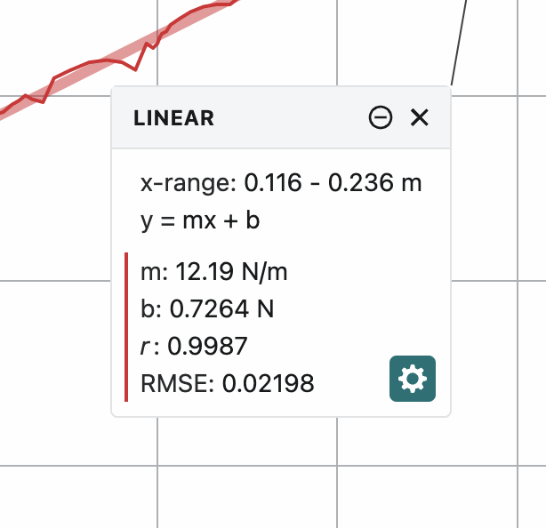
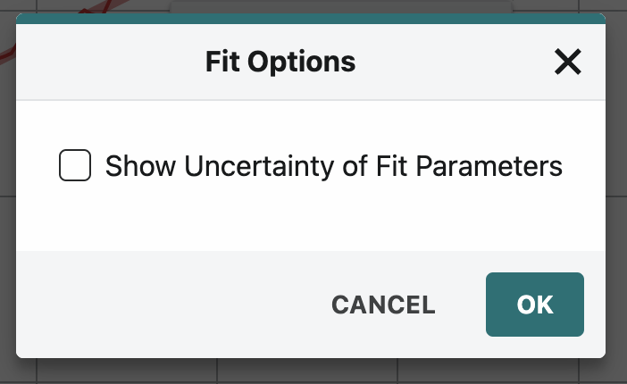

# Lab 4 – Model Building

## PH 213 – General Physics with Calculus

**Experimental goal: Quantify the relationship between geometry and resistance using conductive paper.**

## Learning Objectives

**Learning goal: Develop and test a model, then extend the model to describe a more complicated physical system.**

This activity is designed to help you practice the following skills:

1.  Use physical understanding to finish developing a model to be tested.
2.  Create scatter plots and linearize data.
3.  Determine a functional relationship between variables based on data.
4.  Use a model and previous results to predict an experimental outcome.

## Equipment

::: action
- Pieces of conductive paper of different dimensions with painted traces
- Two metal bars
- Weight in a plastic cup
- Multimeter
:::

::: box
\*\*\* Do not fold the conductive paper or bend the painted traces. \*\*\*
:::

## Part 1: Explore a Model

The electrical resistance *R* of any object of a pure (single) substance depends on two factors. The first is the inherent resistance of the material from which it’s made. This is known as the material’s *resistivity, ρ.* The second is a geometrical factor, which we will call *G*, that depends on the construction of the object. Mathematically, *R = ρ \* G*, with *R* measured in *ohms.*

In this activity you’ll look more closely at this relationship using sheets of conductive paper. We will assume that the sheets all have the same thickness, in which case the factor *G* will depend only on the other dimensions of the sheet. We can then rewrite the above equation as

*R = (ρ / T) \* G~2D~*

where *T* = 0.15 mm is the thickness of the sheet. (Why is it in the denominator?)

In this lab your objective is to determine this modified form of the geometrical factor, *G~2D~*, for a sheet of conductive paper.

For simplicity we’ll confine our investigation to rectangular materials of equal resistivity. So the geometry can be expressed by a length and a width. For consistency we’ll define the length as the distance between the leads (conductive strips) and the width as perpendicular to that, as shown here.

{.drawn drawings="24"}

The paper samples all have painted conductive traces to help you make electrical contact. You can measure the resistance between the traces using the metal bars by placing the bars on the traces and connecting the leads from the meter to them. (You may need to try different meter settings.)

::: {.question #ph213-model-building:predict-dimension-dependence}
**Use your understanding of resistance to predict how the resistance of an object should depend on each of its dimensions. Be quantitative – if something causes the resistance to increase, state the mathematical relationship. Likewise, if you think something causes it to decrease. Explain how you arrived at your predictions.**
:::

## Part 2: Plan the Experiment

::: {.question #ph213-model-building:design-experiments}
**Design experiments to test your predictions. This should include both a description of how you will collect data and how you will use graphs to analyze your data. Decide what to measure, identifying independent and dependent variables.**
:::

::: hint
- Think about the minimum number of data points you need to test your prediction. Remember, a test must include the possibility that your prediction is wrong. So, for example, it takes at least three points to test the prediction of a straight line, since you can always draw a straight line between two points.
:::

## Part 3: Collect Data

::: {.question #ph213-model-building:record-data}
**Perform the experiments and record your data. Include your data table in your report.**

a.  **Estimate the measurement and statistical uncertainty in your resistance measurements. Use them to find the total uncertainty and include that in your final data table. Be sure to explain the source(s) of measurement uncertainty.**
:::

::: {.question #ph213-model-building:describe-observations}
**Describe qualitatively what you observe, without trying to explain.**
:::

::: {.question #ph213-model-building:graph-each-variable}
**Represent the data graphically. Create one graph for each independent variable that you explored.**
:::

## Part 4: Analyze the Data and Draw Conclusions

::: {.question #ph213-model-building:relationship-from-graphs}
**Using the graphs, determine the relationship between the resistance and each of the independent variables. Write down an expression for *G~2D~* in terms of geometrical factors and explain how you used your data to find it.**
:::

::: {.question #ph213-model-building:resistivity-from-graphs}
**Use each graph to determine a resistivity for the paper. What values do you get? What are the units? Considering the uncertainty in your result (see the next question) are your values consistent with each other?**
:::

::: {.question #ph213-model-building:resistivity-uncertainty}
**Determine the uncertainty in your calculation of the resistivity.**

::: action
- **Depending on how you plotted the data, you can use Excel or Graphical Analysis to determine the uncertainty in the slope of your data**
- **The error propagation formula can then be used to find the uncertainty in the resistivity.**
:::
:::

### FINDING UNCERTAINTY IN A SLOPE:

Type the function shown below into a cell in your Excel spreadsheet.

{width="3.2028in" height="1.4833in" crop="0 3262 0 0"}

The function outputs two columns of values. The uncertainty in the slope is the second box down in the left column.

{width="2.8705in" height="1.3083in"}

When using Graphical Analysis, adding uncertainty to fit parameters is an option after performing a curve fit. Clicking on the gear icon on the curve fit opens the Fit Options menu, where uncertainty in fit parameters can be added.

{width="1.7089in" height="1.6197in" crop="10822 9940 7992 10517"}{width="2.8100in" height="1.7200in"}

### FINDING UNCERTAINTY IN A CALCULATED VALUE:

Suppose we have a quantity $w\ $that depends on three other quantities $x,\ y,\ z$, such that $w = \frac{x^{\alpha}y^{\beta}}{z^{\gamma}}$. Each measured quantity has its own uncertainty, $\Delta x,\ \Delta y,\ \Delta z$. Then the uncertainty in $w$ is given by the equation:

$$\Delta w = w*\sqrt{{\alpha\left( \frac{\Delta x}{x} \right)}^{2} + {\beta\left( \frac{\Delta y}{y} \right)}^{2} + {\gamma\left( \frac{\Delta z}{z} \right)}^{2}\ }$$

::: {.question #ph213-model-building:compare-conclusions-predictions}
**Compare your conclusions to your predictions and discuss any discrepancies.**
:::

::: {.question #ph213-model-building:experimental-shortcomings}
**Identify shortcomings of the experimental design by listing at least two major sources of uncertainty and/or inconsistencies in the experiment. Describe changes which could minimize them.**
:::

## Part 5: Extend the Model

In this part you will explore what happens when you measure multiple pieces simultaneously. Start by finding two pieces of paper of the same length and width and similar resistances. Then predict what you will get when you measure a single resistance for both pieces of paper when the pieces are configured as:

::: {.numbered anchors="o10.1 o10.2 o10.3"}
a.  One after the other (connected by a slight overlap on which pressure is applied)

::: hint
- This is referred to as putting the sheets in *series*.
:::

b.  Side-by-side
c.  Stacked on top of each other

::: hint
- Both are examples of putting the sheets in *parallel*.
:::
:::

[Suggestion:]{.underline} When connecting sheets, place the weight in the cup over the point where they meet to ensure better contact. Do *not* use the weight without the cup since the weight is conductive and would affect your measurements.

::: {.question #ph213-model-building:predict-combinations}
***Before* measuring the combinations of sheets, predict what you will find in each case. Be quantitative. Explain how you made your predictions; you may want to refer back to Part 1.**
:::

::: {.question #ph213-model-building:check-predictions}
**Describe and perform an experiment to check your predictions. Be sure to clearly record your results. Before making any conclusions, you may want to repeat your tests using pairs of sheets that are the same as each other but different than the ones you measured. How did the combined resistance in each case compare to the resistances of each individual sheet?**
:::

::: {.question #ph213-model-building:compare-results-predictions}
**Compare your results to your predictions. Do they confirm your ideas on resistance? Defend your answers and speculate on the cause of any differences between your predictions and your results.**
:::

## Part 6: Submit your Group’s Lab Report

Make sure everyone’s name is on your group’s lab report. If you submit through Gradescope remember to add everyone in your group to the assignment. This is done at the end of the submission process.

## Appendix – Reference Information

This section contains key information from previous labs:

1.  Required Plot Elements
2.  Linearization
3.  Uncertainty
4.  Propagating Uncertainty

**[Required Plot Elements]{.underline}**

::: action
- Do not connect the data points with lines.
- Make sure you create *Scatter Plots* and not *Line Plots*.
- Evaluate if the plot makes sense. Are the axes correct? Do you have the right number of data points?
- Include a descriptive title and labels on each axis, always including physical units.
- Add a legend, unless you only have one set of data and the title describes it.
- Display the equation and R^2^ value for any trendline you include.
:::

**[Linearization]{.underline}**

In the context of data analysis, “linear” refers to a directly proportional relationship between the dependent and independent variables in an equation.

::: action
- Mathematically, if two variables $x$ and $y$ have a linear relationship, we can express this as $y = mx + b$ where m and b are constants.
- More simply, we can write this as $y \propto x$ where $\propto$ means “is proportional to”.
- When graphed, data with a linear relationship falls on a straight line.
:::

**Linearization comes in handy when your data or hypothesis is *not* linear.**

When you fit data with a linear trendline, you are essentially checking whether the two variables are proportional to each other. To check a nonlinear hypothesis, can we instead check if one variable is proportional to *a function of* the other variable.

In practice, **linearization is done by calculating a new column of data** that gives the values of a function of the input variable (you will practice this below, so don’t worry if you don’t understand what this means yet). Then, the linearized data can be plotted and analyzed.

**[Why Linearize?]{.underline}**

::: action
- Linear data is typically easier to understand and analyze.
- There are analysis methods we can apply to linear data that don’t work as well (or at all) with nonlinear data.
- It is relatively easy to fit a line to data - there are just two important values to determine: the slope and intercept of the data.
:::

**[Sources of Uncertainty:]{.underline}**

The uncertainty in a measurement can be due to a combination of several factors. A crucial aspect of experimentation is to identify all such sources of uncertainty and to numerically estimate their effect on your measurement result.

Common sources of uncertainty include:

1.  your judgement in reading analogue instruments

<!-- -->

1.  the effects of environmental conditions on the measurement
2.  the sensitivity of your instruments (e.g. a digital scale, a meter stick)
3.  the rating or stated calibration of the instrument
4.  approximations and assumptions that you make while doing the experiment
5.  variations in repeated readings made under apparently identical conditions (statistical uncertainty)

A measurement uncertainty is not meant to be an indication of “mistakes” that you might make in an experiment. If you are aware that you have made a mistake, then you should repeat your experiment. **“Human error” is not a valid source of uncertainty**. If you know that you did something “wrong”, then the right course of action is to redo it correctly.

When a measurement has multiple sources of uncertainty, we can combine them by:

$$\Delta t_{total} = \sqrt{\left( \Delta t_{1} \right)^{2} + \ \left( \Delta t_{2} \right)^{2} + \ \left( \Delta t_{3} \right)^{2} + \ldots}$$

This is called *adding in quadrature*.

**[Uncertainty in a Calculated Quantity (Propagating Uncertainty)]{.underline}**

Suppose we have a quantity $f\ $that depends on three other quantities $x,\ y,\ z$, such that $w = \frac{x^{\alpha}y^{\beta}}{z^{\gamma}}$. Each measured quantity has its own uncertainty, $\Delta x,\ \Delta y,\ \Delta z$. Then the uncertainty in $f$ is given by the equation:

$$\delta w = w*\sqrt{{\alpha\left( \frac{\Delta x}{x} \right)}^{2} + {\beta\left( \frac{\Delta y}{y} \right)}^{2} + {\gamma\left( \frac{\Delta z}{z} \right)}^{2}\ }$$

This is very similar to the equation used to find total uncertainty from multiple sources, with a few important changes.

Each quantity may have different units; by dividing each uncertainty by the measured value, everything in the square root is unitless. You can also think of this as adding the percent uncertainties together (also called relative uncertainty), instead of the uncertainties themselves.

Exponents are just repeated multiplication – for example, $x^{2} = x*x$. In this case, the uncertainty in $x$ would come up twice in the square root, so we would add $\left( \frac{\Delta x}{x} \right)^{2} + \left( \frac{\Delta x}{x} \right)^{2} = 2\left( \frac{\Delta x}{x} \right)^{2}$, which is why exponents become multiplication factors.
