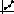

# Lab Handbook

Every lab after the first uses the ideas on this page. Read it before you start a lab, and come back whenever a lab asks for a plot, a fit or an uncertainty.

1.  [Required Plot Elements](#plot-elements)
2.  [Linearization](#linearization)
3.  [What is Uncertainty?](#what-is-uncertainty)
4.  [Sources of Uncertainty](#sources-of-uncertainty)
5.  [Predictions, Hypotheses, and Models](#predictions-hypotheses-models)
6.  [Tips for Using Graphical Analysis](#graphical-analysis-tips)
7.  [Variables and Parameters](#variables-and-parameters)

## Required Plot Elements {#plot-elements}

::: action
- Do not connect the data points with lines.
- Make sure you create *Scatter Plots* and not *Line Plots*.
- Evaluate if the plot makes sense. Are the axes correct? Do you have the right number of data points?
- Include a descriptive title and labels on each axis, always including physical units.
- Add a legend, unless you only have one set of data and the title describes it.
- Display the equation and R^2^ value for any trendline you include.
:::

## Linearization {#linearization}

In the context of data analysis, “linear” refers to a directly proportional relationship between the dependent and independent variables in an equation.

::: action
- Mathematically, if two variables $x$ and $y$ have a linear relationship, we can express this as $y = mx + b$ where m and b are constants.
- More simply, we can write this as $y \propto x$ where $\propto$ means “is proportional to”.
- When graphed, data with a linear relationship falls on a straight line.
:::

**Linearization comes in handy when your data or hypothesis is *not* linear.**

When you fit data with a linear trendline, you are essentially checking whether the two variables are proportional to each other. To check a nonlinear hypothesis, can we instead check if one variable is proportional to *a function of* the other variable.

In practice, **linearization is done by calculating a new column of data** that gives the values of a function of the input variable. Typically, the input variable is the independent variable, and the function is chosen so that the resulting quantity is proportional to the dependent variable.

**Why Linearize?**

::: action
- Linear data is typically easier to understand and analyze.
- There are analysis methods we can apply to linear data that don’t work as well (or at all) with nonlinear data.
- It is relatively easy to fit a line to data - there are just two important values to determine: the slope and intercept of the data.
:::

## What is Uncertainty? {#what-is-uncertainty}

*Uncertainty* is the acknowledgement that we cannot measure things exactly, and so any conclusion based on measurements will always include a range of possible answers. When making a measurement, there is no single “true value” of the measurand (measured quantity) that we can determine. Instead, we can define an interval that defines the range of values that we think are *probable* for the measurand. The narrower the interval, the more precisely we can approximate the measurand.

When including uncertainty in a value, we report it as **A ± Δ~A~**. We believe the value is **A**, but we’re unable to rule out the possibility that it’s higher or lower by an amount **Δ~A~**. (Sometimes it’s written +Δ~1~ / -Δ~2~ if the higher and lower ranges are different.) For example, a time might be reported as 2.45 s ± 0.03 s.

## Sources of Uncertainty: {#sources-of-uncertainty}

The uncertainty in a measurement can be due to a combination of several factors. A crucial aspect of experimentation is to identify all such sources of uncertainty and to numerically estimate their effect on your measurement result.

Common sources of uncertainty include:

a)  the effects of environmental conditions on the measurement
b)  your judgement in reading analogue instruments
c)  the sensitivity of your instruments (e.g. the digital scale)
d)  the rating or stated calibration of the instrument
e)  approximations and assumptions that you make while doing the experiment
f)  variations in repeated readings made under apparently identical conditions

## Predictions, Hypotheses, and Models {#predictions-hypotheses-models}

Experiments are designed to check our understanding of the physical world. An idea about how the world works is a **hypothesis** and is often represented by a **model** that quantifies this idea. In physics, a model is usually an equation. Based on a hypothesis, scientists make specific **predictions** about what will happen in their experiment.

For an experiment to be a valid test of a hypothesis, it must be designed so that the data (and subsequent analysis) can either agree or disagree with the prediction. If the data agree, then we say the hypothesis is **supported** by the data, if not, it is refuted.

We do not refer to hypotheses as “correct” or “incorrect”, rather we discuss the degree to which data support our hypotheses. Models are always just that - a model to describe what we observe. Experiments help us determine to what degree our model works.

## Tips for Using Graphical Analysis: {#graphical-analysis-tips}

::: hint
- Adjust what is displayed using *View* icon, {width="0.1417in" height="0.1417in"} (top right corner). This will allow you to change the number of graphs displayed and to display the data tables.
- Adjust the graph display and fit data using the *Graph Tools* {width="0.1417in" height="0.1417in"} .
- Change what is shown on either axis of a graph by clicking on the axis label.
:::

Change the data collection by clicking on *Mode* (bottom left) and choosing *Data Collection Settings*. You can adjust other items as well using the *Mode* menu.

## Variables and Parameters {#variables-and-parameters}

It will help you when designing your experiment to think about the different types of numerical quantities that are involved. It will make your explanation clearer if you label the different quantities appropriately.

*Independent variable*: In an experiment you will usually vary one quantity at a time in a controlled manner. This is the independent variable. Typically, you’re trying to discover how the independent variable affects the system.

*Dependent variables*: Your hypothesis should predict the behavior of other quantities in your system as the independent variable is changed. These other quantities are referred to as the dependent variables because their values depend on the value of the independent variable.

*Parameters*: There are other quantities you should specify because they may influence your results, but that will remain fixed throughout the experiment. These are referred to as parameters. Examples could be the length of a track or the mass of an object. The key is that a parameter doesn’t change at any time in the experiment.

In short, parameters are fixed, and variables change. The change is either under your control (independent) or a response to the experiment (dependent).
